# EDA Report — AI Impact on Students

Kết quả chạy: 17/11/2026 09:14:53 (UTC+7).

> Dữ liệu synthetic; giấy phép CC0-1.0; publisher version 1. Test (7,500 dòng) chỉ được dùng cho counts và integrity, không dùng target distribution, fit hoặc metrics. Các mô hình có biến AI/hành vi là conditional / retrospective do timing chưa xác minh. Không suy luận nhân quả.

## 01. Tóm tắt và phạm vi

Mục tiêu là dự đoán Post_Semester_GPA trước khi biết GPA cuối kỳ. Pre_Semester_GPA là baseline học tập; GPA_Change = Post − Pre chỉ là outcome phân tích, tuyệt đối không dùng làm predictor. Phân tích chi tiết dùng train; các so sánh mô hình định trước dùng cùng validation rows.

Pre-only OLS: validation RMSE=0.1823, R²=0.8644. Academic OLS: RMSE=0.1626. Academic + AI OLS: RMSE=0.1571, R²=0.8993. E3 − E2 có ΔRMSE=-0.00545, ΔR²=+0.00710. Giá trị bổ sung được ghi nhận trong retrospective scenario; chưa chứng minh lợi ích forecast khi triển khai. [T29]

### T01 · Dataset Overview

Scope: `full_structural_audit` · [CSV đầy đủ](tables/T01_dataset_overview.csv)

|   rows |   columns |   file_bytes |   missing_optional |   extra_columns | encoding   |
|-------:|----------:|-------------:|-------------------:|----------------:|:-----------|
|  50000 |        16 |      5892478 |                nan |             nan | utf-8-sig  |

## 02. Chất lượng dữ liệu và split

Structural audit toàn file: 0 ô blank/missing; 0 dòng bị loại khỏi regression population. Không coi 0 là missing. Numeric parsing, whitespace/case mapping và domain rules được log. Chỉ exact duplicates bị loại; các ID/content liên quan được group trước split. Split thực tế: train=35,000, validation=7,500, test=7,500; seed=42. [T05–T09, T41]

### T05 · Missing Values Summary

Scope: `full_structural_audit` · [CSV đầy đủ](tables/T05_missing_values_summary.csv)

| feature                    |   missing_count |   missing_pct |   denominator |
|:---------------------------|----------------:|--------------:|--------------:|
| Student_ID                 |               0 |             0 |         50000 |
| Major_Category             |               0 |             0 |         50000 |
| Year_of_Study              |               0 |             0 |         50000 |
| Pre_Semester_GPA           |               0 |             0 |         50000 |
| Weekly_GenAI_Hours         |               0 |             0 |         50000 |
| Primary_Use_Case           |               0 |             0 |         50000 |
| Prompt_Engineering_Skill   |               0 |             0 |         50000 |
| Tool_Diversity             |               0 |             0 |         50000 |
| Paid_Subscription          |               0 |             0 |         50000 |
| Traditional_Study_Hours    |               0 |             0 |         50000 |
| Perceived_AI_Dependency    |               0 |             0 |         50000 |
| Institutional_Policy       |               0 |             0 |         50000 |
| Anxiety_Level_During_Exams |               0 |             0 |         50000 |
| Post_Semester_GPA          |               0 |             0 |         50000 |
| Skill_Retention_Score      |               0 |             0 |         50000 |
| Burnout_Risk_Level         |               0 |             0 |         50000 |

### T06 · Duplicate Records Summary

Scope: `full_structural_audit` · [CSV đầy đủ](tables/T06_duplicate_records_summary.csv)

| issue                          |   groups |   affected_rows |   removed_rows | action                                        |
|:-------------------------------|---------:|----------------:|---------------:|:----------------------------------------------|
| exact duplicate                |        0 |               0 |              0 | remove subsequent exact records               |
| duplicate content excluding ID |        0 |               0 |              0 | retain different IDs; group connected content |
| repeated nonmissing Student ID |        0 |               0 |              0 | group all records                             |
| same ID conflicting content    |        0 |               0 |              0 | retain and group; investigate                 |

T07 có 20 domain/coercion checks; 0 checks ghi nhận vi phạm. Predictor invalid được chuyển missing để impute train-only; target invalid không được impute. Outlier hợp lệ được giữ lại, không tự động xóa.

### T08 · Outlier Summary

Scope: `train` · [CSV đầy đủ](tables/T08_outlier_summary.csv)

| feature                    |   valid_n |     iqr |   lower_fence |   upper_fence |   flagged_count |   flagged_pct | reason                                                            |
|:---------------------------|----------:|--------:|--------------:|--------------:|----------------:|--------------:|:------------------------------------------------------------------|
| Pre_Semester_GPA           |     35000 |  0.685  |        1.8085 |        4.5485 |             234 |       0.66857 | nan                                                               |
| Weekly_GenAI_Hours         |     35000 |  9.3025 |      -11.564  |       25.646  |            1832 |       5.2343  | nan                                                               |
| Tool_Diversity             |     35000 |  2      |       -1      |        7      |             nan |     nan       | IQR not meaningful: discrete/ordinal, constant, missing, or IQR=0 |
| Traditional_Study_Hours    |     35000 |  7.19   |       -3.265  |       25.495  |             107 |       0.30571 | nan                                                               |
| Perceived_AI_Dependency    |     35000 |  3      |       -2.5    |        9.5    |             nan |     nan       | IQR not meaningful: discrete/ordinal, constant, missing, or IQR=0 |
| Anxiety_Level_During_Exams |     35000 |  3      |       -1.5    |       10.5    |             nan |     nan       | IQR not meaningful: discrete/ordinal, constant, missing, or IQR=0 |
| Post_Semester_GPA          |     35000 |  0.726  |        1.934  |        4.838  |             237 |       0.67714 | nan                                                               |
| Skill_Retention_Score      |     35000 | 18.293  |       39.379  |      112.55   |             156 |       0.44571 | nan                                                               |

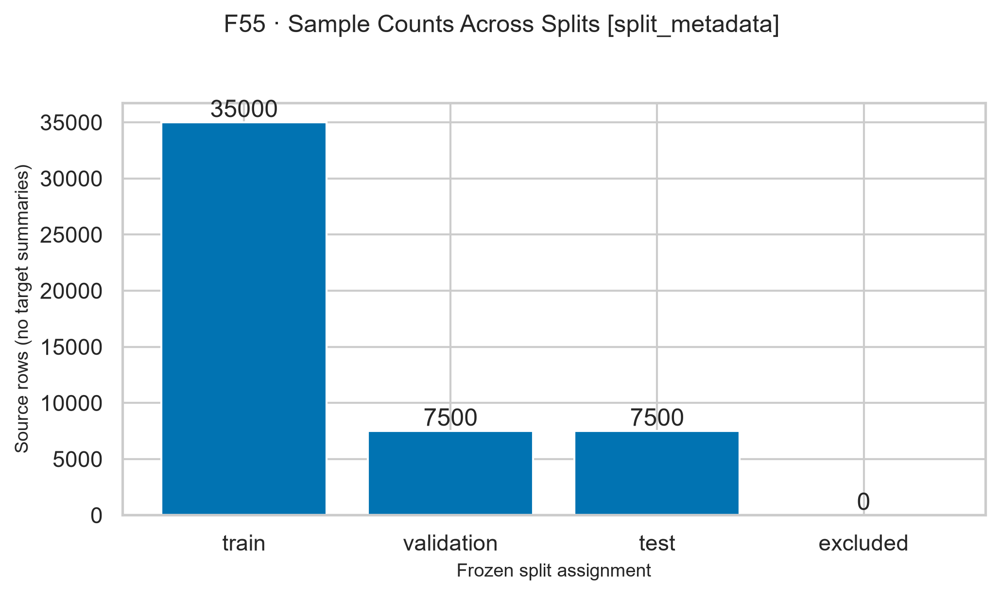

Counts từ frozen assignments; không chứa phân phối target test.

## 03. Thống kê mô tả và phân phối

Thống kê chỉ dùng train. Sample std/variance dùng ddof=1; kurtosis là excess Fisher (normal=0). Ordinal được xem thêm bằng tần suất; mean của numeric rating không chứng minh khoảng cách thang đo bằng nhau. Predictors không cần phân phối chuẩn để fit OLS.

### T10 · Numerical Descriptive Statistics

Scope: `train` · [CSV đầy đủ](tables/T10_numerical_descriptive_statistics.csv)

| feature                    |   valid_n |    mean |   median |      std |   minimum |   maximum |     q1 |     q3 |   skewness |
|:---------------------------|----------:|--------:|---------:|---------:|----------:|----------:|-------:|-------:|-----------:|
| Pre_Semester_GPA           |     35000 |  3.1469 |    3.211 |  0.47912 |     1.183 |     3.998 |  2.836 |  3.521 |   -0.61179 |
| Weekly_GenAI_Hours         |     35000 |  8.4366 |    5.8   |  8.2825  |     0     |    40     |  2.39  | 11.693 |    1.6062  |
| Tool_Diversity             |     35000 |  2.8027 |    3     |  1.1912  |     1     |     5     |  2     |  4     |    0.16885 |
| Traditional_Study_Hours    |     35000 | 11.196  |   11.18  |  5.1529  |     1     |    35.86  |  7.52  | 14.71  |    0.12407 |
| Perceived_AI_Dependency    |     35000 |  3.5019 |    3     |  1.8214  |     1     |    10     |  2     |  5     |    0.65867 |
| Anxiety_Level_During_Exams |     35000 |  4.2768 |    4     |  2.1491  |     1     |    10     |  3     |  6     |    0.36327 |
| Post_Semester_GPA          |     35000 |  3.3496 |    3.424 |  0.49649 |     1     |     4     |  3.023 |  3.749 |   -0.68505 |
| Skill_Retention_Score      |     35000 | 75.805  |   75.99  | 13.252   |    10.78  |   100     | 66.817 | 85.11  |   -0.21661 |

Weekly GenAI Hours có mean=8.437, median=5.800 giờ/tuần, skewness=1.606. Phân phối lệch phải là lý do khảo sát log/centering, chưa phải lý do loại biến. [T10/T35]

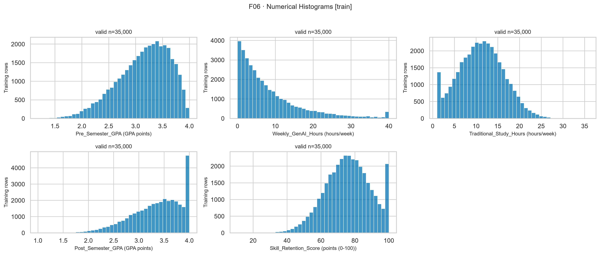

Histogram của các biến continuous, bao gồm target và auxiliary outcomes đúng vai trò.

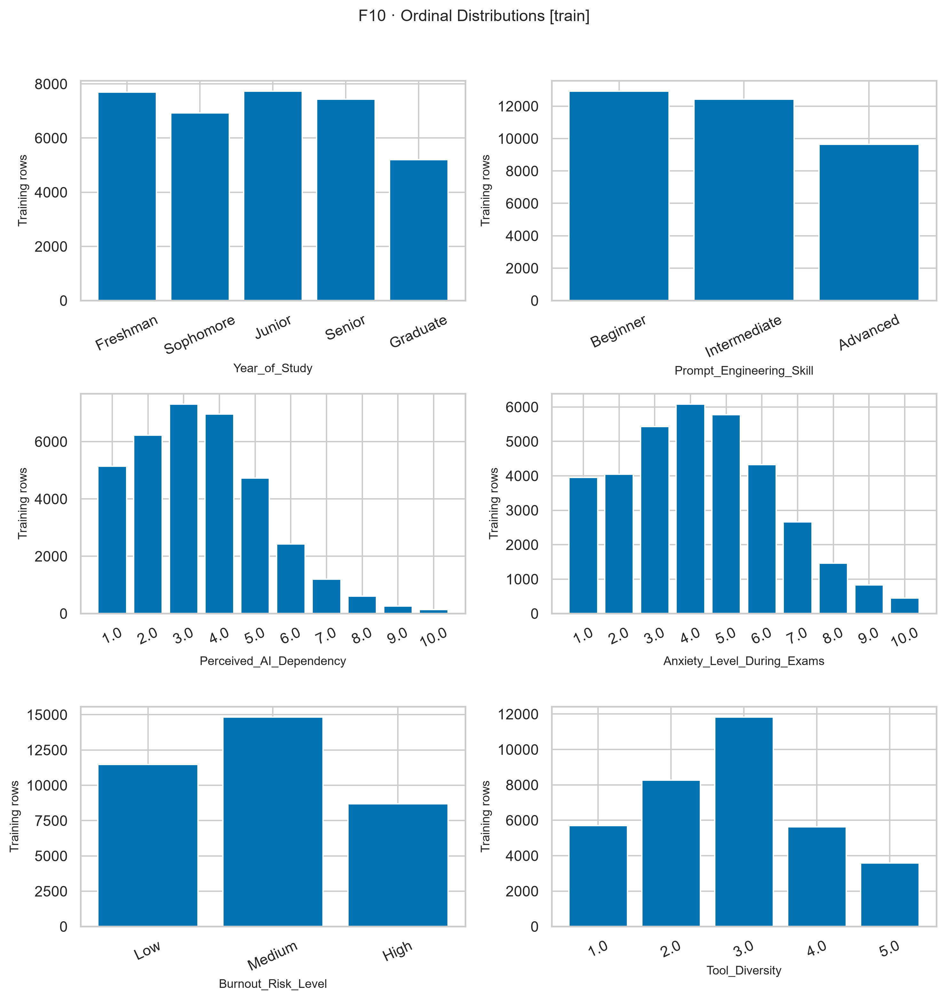

Ordinal/discrete dùng bar chart có thứ tự; không áp dụng KDE cho category codes.

## 04. Target GPA và thay đổi GPA

Paired valid n=35,000; mean GPA Change=0.2027, median=0.2040, sample std=0.1879. Improved/unchanged/declined dùng tolerance 1e-9 để xử lý sai số float; chưa phải ngưỡng thay đổi có ý nghĩa học thuật. [T15/T16]

### T16 · Improvement Summary

Scope: `train` · [CSV đầy đủ](tables/T16_improvement_summary.csv)

| status    |   count |   percentage |   denominator |   tolerance |
|:----------|--------:|-------------:|--------------:|------------:|
| Improved  |   30575 |     87.357   |         35000 |       1e-09 |
| Unchanged |      36 |      0.10286 |         35000 |       1e-09 |
| Declined  |    4389 |     12.54    |         35000 |       1e-09 |

### T18 · GPA Boundary Concentration

Scope: `train` · [CSV đầy đủ](tables/T18_gpa_boundary_concentration.csv)

| feature           | boundary_type   |   boundary |   count |   percentage |   valid_n | reason                                                                  |
|:------------------|:----------------|-----------:|--------:|-------------:|----------:|:------------------------------------------------------------------------|
| Pre_Semester_GPA  | upper           |          4 |       0 |       0      |     35000 | source-documented upper endpoint                                        |
| Pre_Semester_GPA  | lower           |        nan |     nan |     nan      |     35000 | theoretical lower boundary unverified; not inferred from sample minimum |
| Post_Semester_GPA | upper           |          4 |    3371 |       9.6314 |     35000 | source-documented upper endpoint                                        |
| Post_Semester_GPA | lower           |        nan |     nan |     nan      |     35000 | theoretical lower boundary unverified; not inferred from sample minimum |

Ceiling chỉ xét upper endpoint 4.0 được mô tả bởi nguồn; theoretical floor chưa được xác minh. GPA Change có mathematical coupling với Pre GPA và có thể chịu ceiling/regression to the mean; không đồng nghĩa tác động của AI.

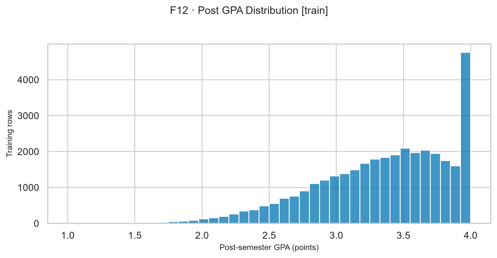

Phân phối Post GPA trên train.

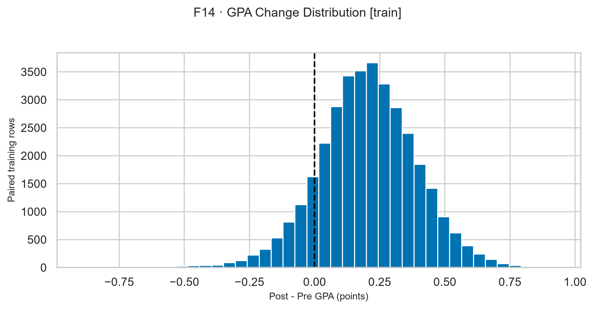

Thay đổi GPA quan sát trên cùng các paired training rows.

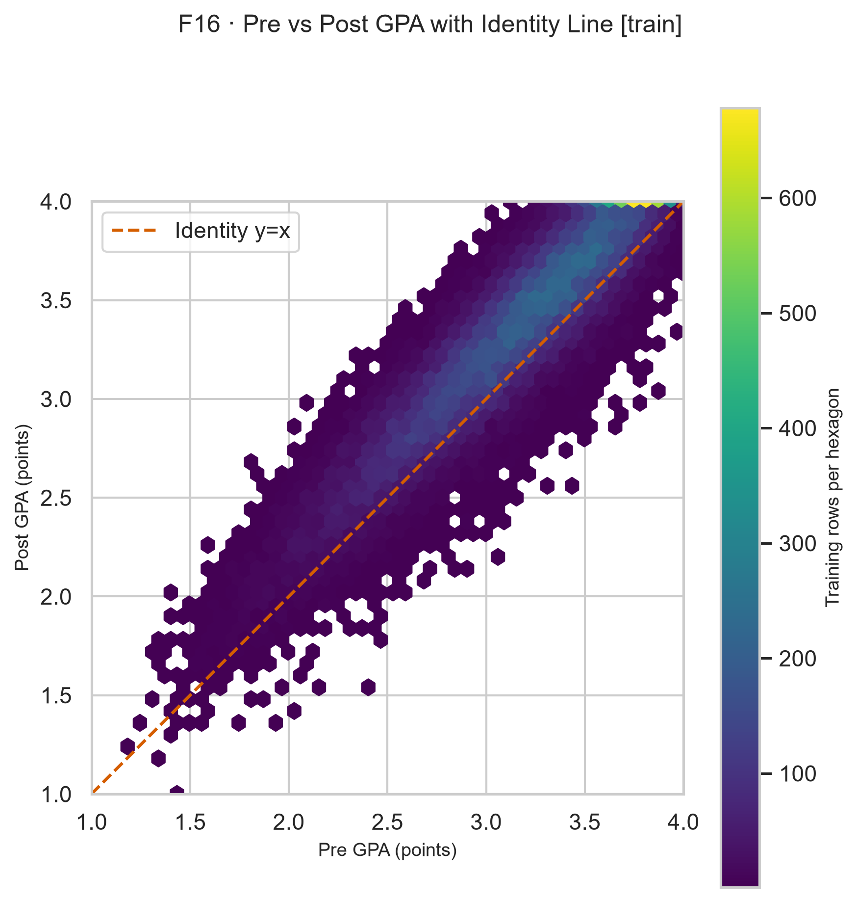

Pre và Post cùng thang trục, kèm identity line y=x; màu biểu thị count.

## 05. Quan hệ hai biến và nhóm sinh viên

Pearson dùng quantitative features; Spearman dùng quantitative/ordinal có thứ tự được xác minh. Nominal không được gán số tùy ý. Bảng nêu valid pair count; liên hệ marginal không tự quyết định feature selection.

### T19 · Pearson with Target

Scope: `train` · [CSV đầy đủ](tables/T19_pearson_with_target.csv)

| feature                 | outcome           |   valid_n |   coefficient |   reason |
|:------------------------|:------------------|----------:|--------------:|---------:|
| Pre_Semester_GPA        | Post_Semester_GPA |     35000 |      0.92641  |      nan |
| Weekly_GenAI_Hours      | Post_Semester_GPA |     35000 |     -0.019141 |      nan |
| Tool_Diversity          | Post_Semester_GPA |     35000 |      0.025963 |      nan |
| Traditional_Study_Hours | Post_Semester_GPA |     35000 |      0.13379  |      nan |
| Pre_Semester_GPA        | GPA_Change        |     35000 |     -0.10199  |      nan |
| Weekly_GenAI_Hours      | GPA_Change        |     35000 |     -0.048109 |      nan |
| Tool_Diversity          | GPA_Change        |     35000 |      0.082718 |      nan |
| Traditional_Study_Hours | GPA_Change        |     35000 |      0.3775   |      nan |

### T20 · Spearman with Target

Scope: `train` · [CSV đầy đủ](tables/T20_spearman_with_target.csv)

| feature                    | outcome           |   valid_n |   coefficient |   reason |
|:---------------------------|:------------------|----------:|--------------:|---------:|
| Pre_Semester_GPA           | Post_Semester_GPA |     35000 |     0.91605   |      nan |
| Weekly_GenAI_Hours         | Post_Semester_GPA |     35000 |     0.0079456 |      nan |
| Tool_Diversity             | Post_Semester_GPA |     35000 |     0.030001  |      nan |
| Traditional_Study_Hours    | Post_Semester_GPA |     35000 |     0.13674   |      nan |
| Perceived_AI_Dependency    | Post_Semester_GPA |     35000 |    -0.0093986 |      nan |
| Anxiety_Level_During_Exams | Post_Semester_GPA |     35000 |    -0.013514  |      nan |
| Year_of_Study              | Post_Semester_GPA |     35000 |     0.083977  |      nan |
| Prompt_Engineering_Skill   | Post_Semester_GPA |     35000 |     0.041122  |      nan |
| Pre_Semester_GPA           | GPA_Change        |     35000 |    -0.1151    |      nan |
| Weekly_GenAI_Hours         | GPA_Change        |     35000 |     0.031337  |      nan |
| Tool_Diversity             | GPA_Change        |     35000 |     0.081143  |      nan |
| Traditional_Study_Hours    | GPA_Change        |     35000 |     0.37143   |      nan |
| Perceived_AI_Dependency    | GPA_Change        |     35000 |    -0.011843  |      nan |
| Anxiety_Level_During_Exams | GPA_Change        |     35000 |    -0.025614  |      nan |
| Year_of_Study              | GPA_Change        |     35000 |     0.23694   |      nan |
| Prompt_Engineering_Skill   | GPA_Change        |     35000 |     0.12096   |      nan |

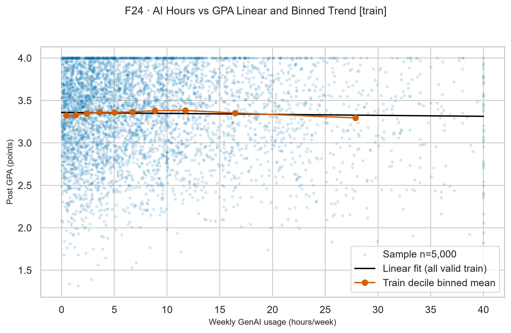

Linear fit và train-decile binned trend; scatter sampling có seed, correlations dùng toàn bộ valid train pairs.

### T21 · Prompt Skill / Primary Use Case vs Post GPA

Scope: `train` · [CSV đầy đủ](tables/T21_categorical_vs_target_summary.csv)

| feature                  | group                     |   valid_n |   mean |   median |     std |   ci95_low |   ci95_high | small_group   |
|:-------------------------|:--------------------------|----------:|-------:|---------:|--------:|-----------:|------------:|:--------------|
| Primary_Use_Case         | Copywriting/Drafting      |      8443 | 3.335  |   3.401  | 0.49545 |     3.3244 |      3.3455 | False         |
| Primary_Use_Case         | Debugging/Troubleshooting |      8581 | 3.3968 |   3.477  | 0.48759 |     3.3865 |      3.4071 | False         |
| Primary_Use_Case         | Direct_Answer_Generation  |      4418 | 3.2943 |   3.3625 | 0.51269 |     3.2792 |      3.3094 | False         |
| Primary_Use_Case         | Ideation                  |      7497 | 3.3469 |   3.419  | 0.49681 |     3.3356 |      3.3581 | False         |
| Primary_Use_Case         | Summarizing_Reading       |      6061 | 3.347  |   3.426  | 0.49244 |     3.3346 |      3.3594 | False         |
| Prompt_Engineering_Skill | Beginner                  |     12925 | 3.3366 |   3.408  | 0.49764 |     3.328  |      3.3452 | False         |
| Prompt_Engineering_Skill | Intermediate              |     12428 | 3.3334 |   3.4045 | 0.49371 |     3.3247 |      3.3421 | False         |
| Prompt_Engineering_Skill | Advanced                  |      9647 | 3.388  |   3.464  | 0.49652 |     3.3781 |      3.3979 | False         |

95% t-based mean CIs là descriptive và phụ thuộc giả định independence chưa xác minh. Nhóm n<30 được flag. Chênh lệch nhóm chưa điều chỉnh không được diễn giải là causal effect.

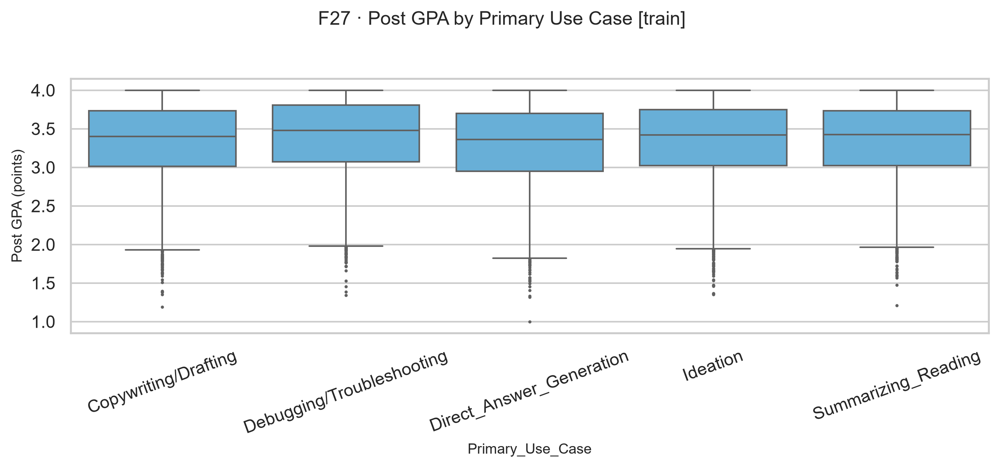

Phân phối GPA theo mục đích AI, group n trong T21.

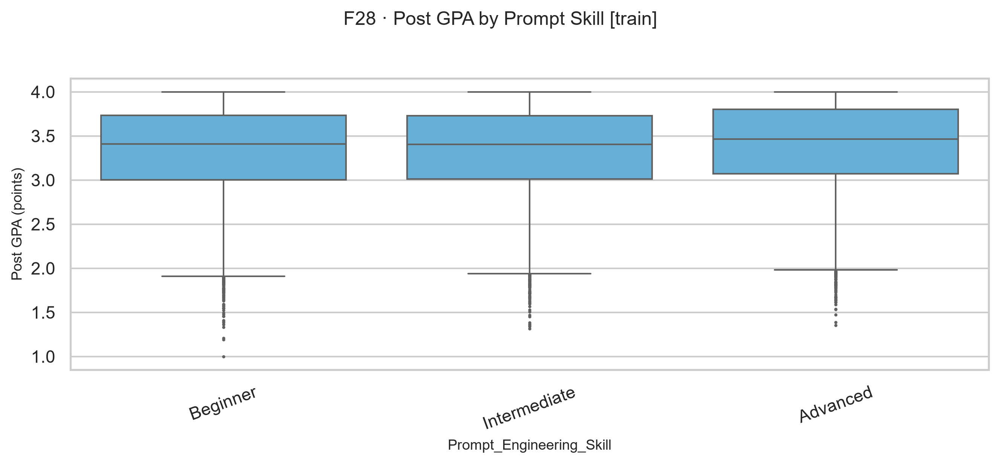

Phân phối GPA theo mức Prompt Skill, không giả định equal ordinal spacing.

## 06. Quan hệ đa biến và subgroup

Phân tầng trên train để khảo sát AI Hours × Prompt Skill, Major, Study Hours, Pre GPA, Dependency; Use Case × Prompt; Dependency × Anxiety; và auxiliary Retention. Bins/edges được lưu ở T25; từng grouped trend có count và bounds ở T26. Heatmap mask cell n<30; không tô 0 vào ô thiếu.

### T23 · AI Usage Intensity Groups

Scope: `train` · [CSV đầy đủ](tables/T23_ai_usage_intensity_groups.csv)

| group          |   valid_n |    mean |   median |     std |   ci95_low |   ci95_high | small_group   |
|:---------------|----------:|--------:|---------:|--------:|-----------:|------------:|:--------------|
| (-0.001, 2.39] |      8760 | 0.18737 |   0.187  | 0.17575 |    0.18369 |     0.19105 | False         |
| (2.39, 5.8]    |      8742 | 0.20513 |   0.2    | 0.17664 |    0.20142 |     0.20883 | False         |
| (5.8, 11.692]  |      8748 | 0.22908 |   0.225  | 0.17534 |    0.2254  |     0.23275 | False         |
| (11.692, 40.0] |      8750 | 0.18915 |   0.2015 | 0.21751 |    0.18459 |     0.1937  | False         |

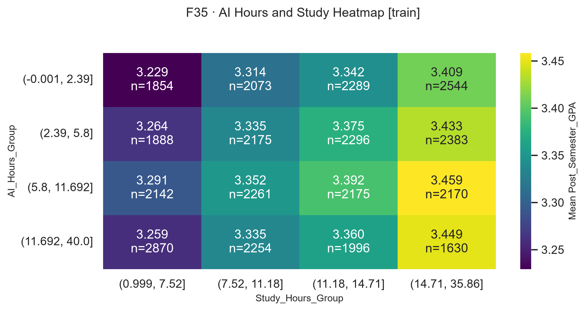

Mỗi ô: mean GPA và valid n. Hai chiều được sắp theo thứ tự quantile thực tế.

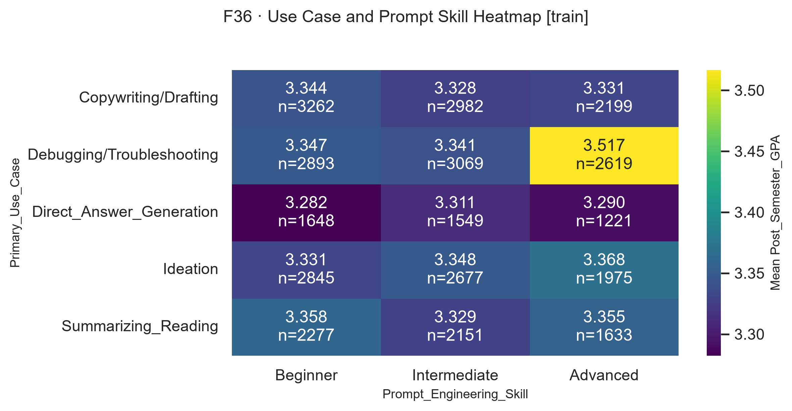

Use Case × Prompt Skill: liên hệ có điều kiện theo subgroup, chưa phải causal moderation.

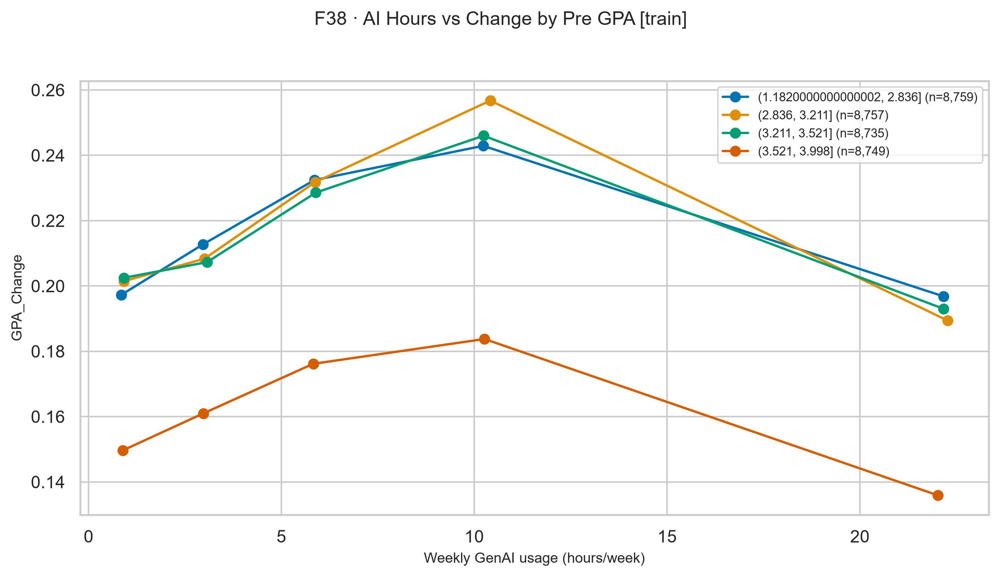

GPA Change theo AI Hours và Pre GPA groups; vẫn có mathematical coupling với Pre GPA.

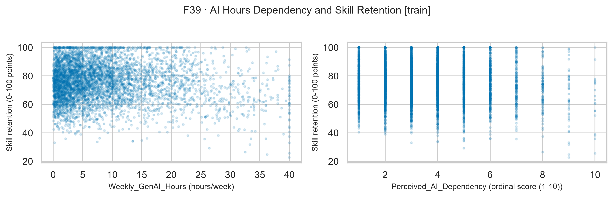

Retention chỉ là auxiliary outcome, tuyệt đối không nằm trong predictor matrix.

## 07. Hồi quy thăm dò trên validation

Fit train-only: numeric median; categorical mode + one-hot drop-first, xử lý unknown categories. E0a là train-mean; E0b persistence Pre GPA; E1 Pre-only; E2 academic; E3 academic + AI. Mọi model dùng cùng validation rows, không tuning cuối cùng. E2/E3 thêm các biến timing unknown nên có nhãn conditional / retrospective.

### T29 · Exploratory Regression Results

Scope: `validation` · [CSV đầy đủ](tables/T29_exploratory_regression_results.csv)

| model   | scenario                                                                           |   valid_n |     MAE |      MSE |    RMSE |          R2 |   adjusted_R2_train | delta_reference   |   delta_RMSE |    delta_R2 |
|:--------|:-----------------------------------------------------------------------------------|----------:|--------:|---------:|--------:|------------:|--------------------:|:------------------|-------------:|------------:|
| E0a     | train-mean reference                                                               |      7500 | 0.40518 | 0.2452   | 0.49518 | -0.00013552 |           nan       | nan               |  nan         | nan         |
| E0b     | pre-semester persistence                                                           |      7500 | 0.23037 | 0.076004 | 0.27569 |  0.68999    |           nan       | nan               |  nan         | nan         |
| E1      | pre-semester baseline; deployment timing still requires institutional verification |      7500 | 0.14127 | 0.03325  | 0.18234 |  0.86438    |             0.85823 | E0a               |   -0.31283   |   0.86452   |
| E2      | conditional / retrospective academic                                               |      7500 | 0.12581 | 0.026425 | 0.16256 |  0.89222    |             0.88725 | E1                |   -0.019789  |   0.027838  |
| E3      | conditional / retrospective academic + AI; exam anxiety high temporal risk         |      7500 | 0.12302 | 0.024683 | 0.15711 |  0.89932    |             0.89527 | E2                |   -0.0054471 |   0.0071022 |

Adjusted R² thuộc TRAIN fitted sample; các metrics MAE/MSE/RMSE/R² ở cột đánh giá thuộc VALIDATION. R² âm được giữ nếu xảy ra. Raw coefficients khác đơn vị không phải feature importance; reference categories có trong T30 và preprocessing_log.csv.

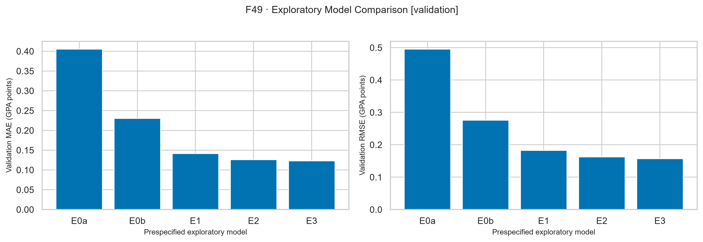

So sánh validation exploratory trên cùng sample population. Không có test metrics.

## 08. Đa cộng tuyến, phần dư và influence

Encoded design: n=35,000, rank=40/40; max VIF=2.7678; condition number raw=289.438, standardized=4.320. VIF xét từng encoded term có intercept; ngưỡng 5/10 là heuristic, không phải quy tắc xóa. [T28]

### T28 · 15 encoded terms có VIF cao nhất; toàn bộ terms trong CSV

Scope: `train` · [CSV đầy đủ](tables/T28_vif_analysis.csv)

| encoded_term                                    | original_feature           |    VIF | heuristic   |
|:------------------------------------------------|:---------------------------|-------:|:------------|
| cat__Major_Category_STEM                        | Major_Category             | 2.7678 | low         |
| cat__Major_Category_Business                    | Major_Category             | 2.5277 | low         |
| cat__Prompt_Engineering_Skill_Beginner          | Prompt_Engineering_Skill   | 2.3328 | low         |
| num__Weekly_GenAI_Hours                         | Weekly_GenAI_Hours         | 2.1998 | low         |
| cat__Major_Category_Humanities                  | Major_Category             | 2.1445 | low         |
| cat__Anxiety_Level_During_Exams_4.0             | Anxiety_Level_During_Exams | 2.1219 | low         |
| cat__Anxiety_Level_During_Exams_5.0             | Anxiety_Level_During_Exams | 2.0948 | low         |
| cat__Perceived_AI_Dependency_4.0                | Perceived_AI_Dependency    | 2.0195 | low         |
| cat__Anxiety_Level_During_Exams_3.0             | Anxiety_Level_During_Exams | 2.0171 | low         |
| cat__Perceived_AI_Dependency_3.0                | Perceived_AI_Dependency    | 1.9751 | low         |
| cat__Major_Category_Medical                     | Major_Category             | 1.9494 | low         |
| cat__Perceived_AI_Dependency_5.0                | Perceived_AI_Dependency    | 1.9059 | low         |
| cat__Primary_Use_Case_Debugging/Troubleshooting | Primary_Use_Case           | 1.8856 | low         |
| cat__Anxiety_Level_During_Exams_6.0             | Anxiety_Level_During_Exams | 1.8847 | low         |
| cat__Perceived_AI_Dependency_2.0                | Perceived_AI_Dependency    | 1.8345 | low         |

### T31 · Regression Assumption Diagnostics

Scope: `train` · [CSV đầy đủ](tables/T31_regression_assumption_diagnostics.csv)

| check                                     |         value | method                                                               | limitation                                                                                 |
|:------------------------------------------|--------------:|:---------------------------------------------------------------------|:-------------------------------------------------------------------------------------------|
| mean specification                        |   -3.5434e-15 | train residual mean; inspect residual vs fitted and key predictors   | zero mean with intercept does not prove linearity                                          |
| residual variance                         |    0.025816   | SSE / residual df                                                    | inspect scale-location; heteroscedasticity possible                                        |
| residual normality                        |   -0.21842    | residual skewness + histogram + Q-Q                                  | normality affects inference, not a predictor normality requirement                         |
| independence                              |  nan          | sampling/design audit; ID grouping before split                      | unknown sampling design and synthetic generator; residual plots cannot verify independence |
| rank                                      |   40          | 40 design columns including intercept                                | pinv coefficients not identified if rank deficient                                         |
| predictions above documented GPA endpoint | 1893          | unclipped train fitted predictions                                   | no silent clipping; floor unknown                                                          |
| large internally standardized residual    |  188          | abs(e / sqrt(MSE*(1-h))) > 3                                         | heuristic; retain observations                                                             |
| high leverage                             | 1387          | h > 2p/n; threshold=0.0022857143; n=35000; p=40                      | heuristic, not an exclusion rule                                                           |
| large Cook distance                       | 1641          | Cook D > 4/n; threshold=0.00011428571; rank used in Cook denominator | heuristic; inspect, do not delete automatically                                            |
| optional formal tests                     |  nan          | skipped: RUN_OPTIONAL_TESTS=False or singular design                 | core visual/effect-size diagnostics retained                                               |

Residual = actual − fitted. Standardized residual là loại internally standardized; |r|>3, h>2p/n và Cook D>4/n chỉ để điều tra. Không tự động loại observations. Independence cần sampling/design evidence; residual normality liên quan inference, không phải predictor normality.

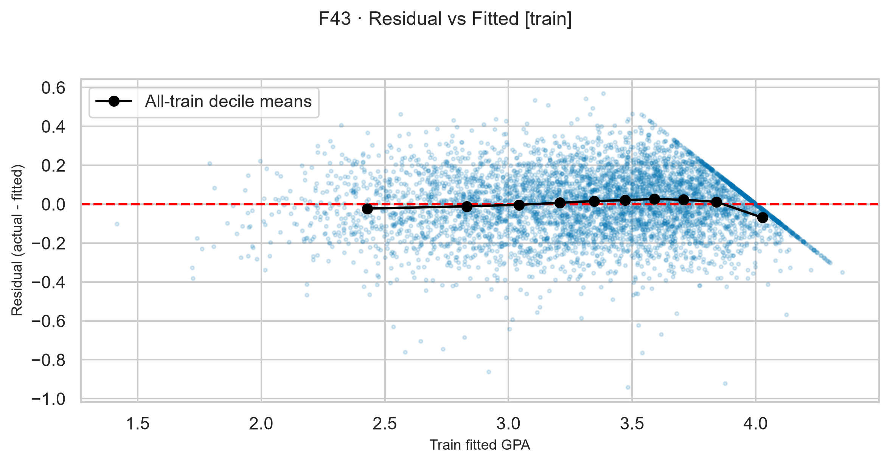

Residual vs fitted và binned mean sau khi fit conditional OLS.

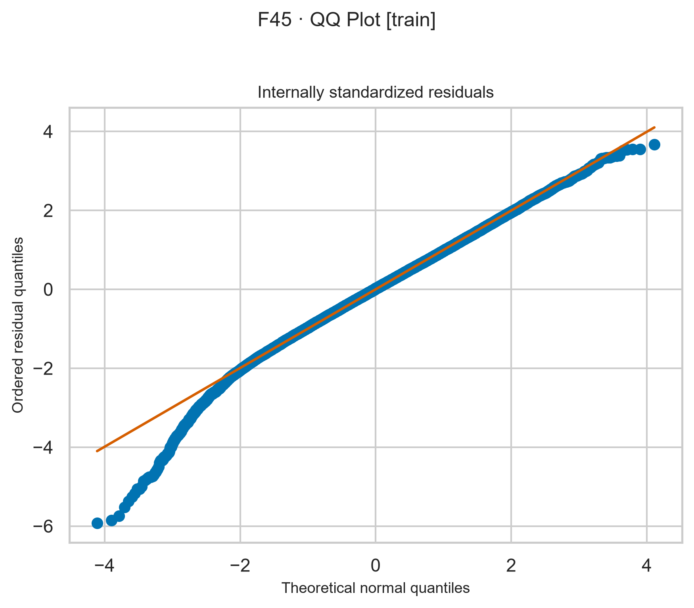

Q-Q của internally standardized train residuals; xem departure thực tiễn cùng quy mô mẫu.

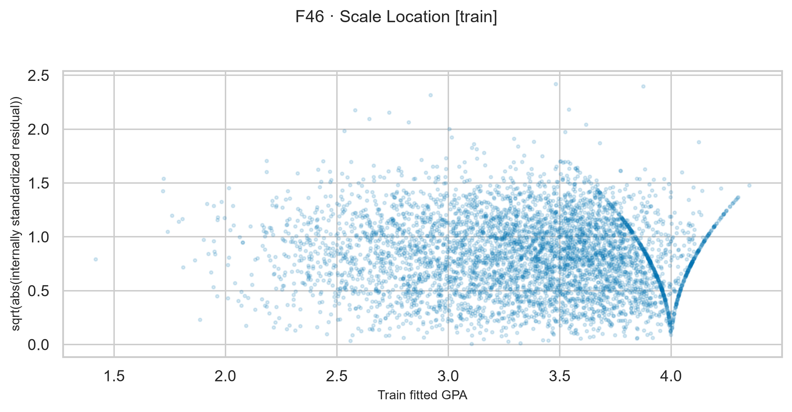

Scale-location để quan sát variance theo fitted GPA; không thay cho xác minh independence.

## 09. Feature engineering

Centering fit bằng train mean; log1p chỉ cho H≥0. Polynomial giữ lower-order H; không ghép raw H và centered H với cùng intercept. Ordinal numeric products chưa có interval-scale evidence nên chỉ proposal. Total Study Hours và AI Study Ratio bị skip khi chưa xác minh AI usage chỉ dành cho study và không double-count.

### T33 · Derived Feature Definitions

Scope: `train` · [CSV đầy đủ](tables/T33_derived_feature_definitions.csv)

| feature                   | formula                                   | status                                 | constraint                                                     | fit_scope                |
|:--------------------------|:------------------------------------------|:---------------------------------------|:---------------------------------------------------------------|:-------------------------|
| GPA_Change                | Post_Semester_GPA - Pre_Semester_GPA      | analytical outcome only                | never predictor                                                | no fitted parameters     |
| Total_Study_Hours         | H + Traditional_Study_Hours               | skipped                                | units + study-only coverage + no double count must be verified | train                    |
| AI_Study_Ratio            | H / Total_Study_Hours                     | skipped                                | valid total >0; zero denominator -> missing                    | train                    |
| AI_Hours_Squared          | H**2                                      | candidate                              | retain H; redundancy audit                                     | train                    |
| Log_AI_Hours              | log1p(H)                                  | candidate                              | finite nonnegative H                                           | train                    |
| Centered_AI_Hours         | H - mean_train(H)                         | candidate                              | never use with raw H and intercept                             | train mean               |
| Centered_AI_Hours_Squared | (H - mean_train(H))**2                    | candidate                              | retain H or centered H; no duplicate linear term               | train mean               |
| AI_Dependency_Interaction | H * Dependency                            | proposal only; skipped numeric product | ordinal interval-distance assumption and timing unverified     | train                    |
| AI_Prompt_Interaction     | centered H * reference-coded Prompt dummy | candidate                              | train reference; retain prompt dummies and H                   | train reference and mean |
| Study_Anxiety_Interaction | Study * Anxiety                           | proposal only; skipped numeric product | high temporal risk; interval-distance assumption unverified    | train                    |

### T35 · Original vs Transformed Comparison

Scope: `validation` · [CSV đầy đủ](tables/T35_original_vs_transformed_comparison.csv)

| candidate                 |   valid_n |   skewness |   pearson_post |   spearman_post |   pair_vif_with_linear_H |   validation_MAE |   validation_RMSE |   validation_R2 |   quadratic_coefficient |
|:--------------------------|----------:|-----------:|---------------:|----------------:|-------------------------:|-----------------:|------------------:|----------------:|------------------------:|
| Original_H                |     35000 |    1.6062  |     -0.019141  |       0.0079456 |                 nan      |          0.12302 |           0.15711 |         0.89932 |            nan          |
| AI_Hours_Squared          |     35000 |    3.2807  |     -0.032094  |       0.0079456 |                   7.8259 |        nan       |         nan       |       nan       |            nan          |
| Log_AI_Hours              |     35000 |   -0.08876 |      0.0028293 |       0.0079456 |                 nan      |        nan       |         nan       |       nan       |            nan          |
| Centered_AI_Hours         |     35000 |    1.6062  |     -0.019141  |       0.0079456 |                 nan      |        nan       |         nan       |       nan       |            nan          |
| Centered_AI_Hours_Squared |     35000 |    4.3665  |     -0.040529  |      -0.04288   |                   2.3266 |          0.12259 |           0.15632 |         0.90033 |             -0.00019737 |
| H_x_Prompt_Beginner       |     35000 |    2.6659  |     -0.0091259 |       0.009594  |                 nan      |        nan       |         nan       |       nan       |            nan          |
| H_x_Prompt_Intermediate   |     35000 |    2.6359  |     -0.014     |       0.0043045 |                 nan      |        nan       |         nan       |       nan       |            nan          |

Fixed E3 + centered H²: validation RMSE=0.15632, ΔRMSE so với E3=-0.000788; quadratic coefficient=-0.0001974. Đây là một comparison định trước, chưa chọn degree hay tuning theo validation. Giảm skewness chưa đồng nghĩa tăng khả năng dự đoán. [T35]

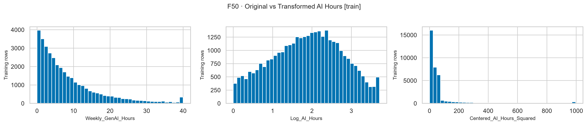

Phân phối original/log/centered-square; transformations không tự động được chọn vào final pipeline.

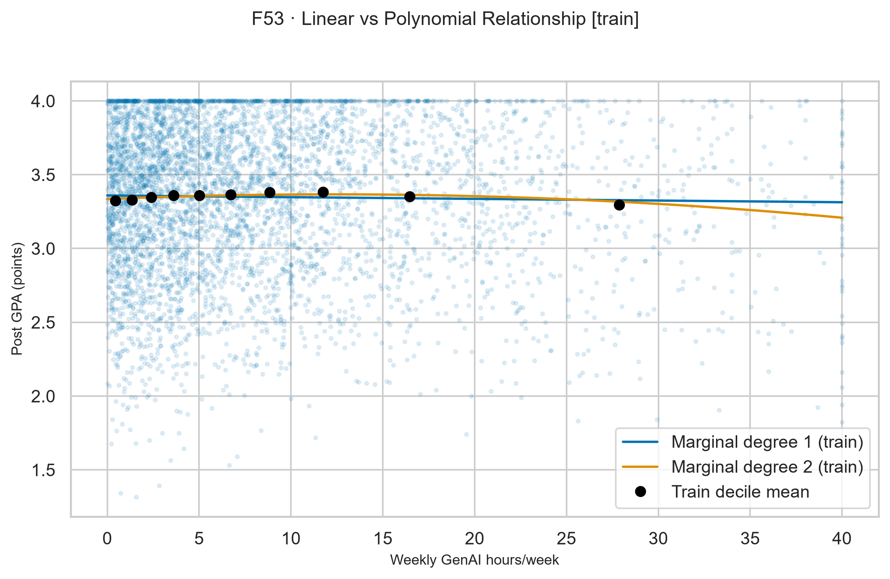

Quan hệ marginal train linear vs quadratic. Comparison validation ở T35 có academic/AI controls của E3.

## 10. Leakage, provenance và bias

Loại target, GPA Change, Student ID, auxiliary Skill Retention/Burnout và các cột không rõ vai trò khỏi X. Pre GPA có định nghĩa trước kỳ; timing của đa số biến khác chưa rõ. Synthetic provenance được xác nhận từ metadata; tính đại diện của cohort thật và generator mechanism vẫn unknown.

### T40 · Feature Availability Matrix

Scope: `split_metadata` · [CSV đầy đủ](tables/T40_feature_availability_matrix.csv)

| feature                    | availability   | allowed_scenario                 | forecast_eligible   | leakage_risk   |
|:---------------------------|:---------------|:---------------------------------|:--------------------|:---------------|
| Student_ID                 | unavailable    | not a predictor                  | False               | high           |
| Major_Category             | unknown        | conditional / retrospective only | False               | conditional    |
| Year_of_Study              | unknown        | conditional / retrospective only | False               | conditional    |
| Pre_Semester_GPA           | available      | pre-semester baseline            | True                | low            |
| Weekly_GenAI_Hours         | unknown        | conditional / retrospective only | False               | conditional    |
| Primary_Use_Case           | unknown        | conditional / retrospective only | False               | conditional    |
| Prompt_Engineering_Skill   | unknown        | conditional / retrospective only | False               | conditional    |
| Tool_Diversity             | unknown        | conditional / retrospective only | False               | conditional    |
| Paid_Subscription          | unknown        | conditional / retrospective only | False               | conditional    |
| Traditional_Study_Hours    | unknown        | conditional / retrospective only | False               | conditional    |
| Perceived_AI_Dependency    | unknown        | conditional / retrospective only | False               | conditional    |
| Institutional_Policy       | unknown        | conditional / retrospective only | False               | conditional    |
| Anxiety_Level_During_Exams | unknown        | conditional / retrospective only | False               | high           |
| Post_Semester_GPA          | unavailable    | not a predictor                  | False               | high           |
| Skill_Retention_Score      | unavailable    | not a predictor                  | False               | high           |
| Burnout_Risk_Level         | unavailable    | not a predictor                  | False               | high           |

### T41 · Split Integrity Report

Scope: `split_metadata` · [CSV đầy đủ](tables/T41_split_integrity_report.csv)

| check                                   | left       | right      | value                                                            | passed   |
|:----------------------------------------|:-----------|:-----------|:-----------------------------------------------------------------|:---------|
| split row count                         | train      | nan        | 35000                                                            | True     |
| row-key overlap                         | train      | validation | 0                                                                | True     |
| connected-group overlap                 | train      | validation | 0                                                                | True     |
| content-hash overlap                    | train      | validation | 0                                                                | True     |
| Student ID overlap                      | train      | validation | 0                                                                | True     |
| row-key overlap                         | train      | test       | 0                                                                | True     |
| connected-group overlap                 | train      | test       | 0                                                                | True     |
| content-hash overlap                    | train      | test       | 0                                                                | True     |
| Student ID overlap                      | train      | test       | 0                                                                | True     |
| split row count                         | validation | nan        | 7500                                                             | True     |
| row-key overlap                         | validation | test       | 0                                                                | True     |
| connected-group overlap                 | validation | test       | 0                                                                | True     |
| content-hash overlap                    | validation | test       | 0                                                                | True     |
| Student ID overlap                      | validation | test       | 0                                                                | True     |
| split row count                         | test       | nan        | 7500                                                             | True     |
| all source rows assigned once           | all        | nan        | 50000                                                            | True     |
| raw CSV unchanged                       | raw        | nan        | 4d911088c4b12d60a450a9acae6b606f4119ebbb48679518e427a4fc00778472 | True     |
| forbidden predictors absent             | models     | nan        | 3                                                                | True     |
| no test target/model frame materialized | test       | nan        | assignment/count/integrity only                                  | True     |

### T42 · Dataset Bias and Limitations

Scope: `split_metadata` · [CSV đầy đủ](tables/T42_dataset_bias_and_limitations.csv)

| issue                      | status                                           | consequence                                                              | action                                                         |
|:---------------------------|:-------------------------------------------------|:-------------------------------------------------------------------------|:---------------------------------------------------------------|
| synthetic provenance       | synthetic                                        | Learns simulated patterns; external validity to real students unverified | No causal or population claims                                 |
| license and version        | CC0-1.0; publisher version=1                     | Local bytes not authenticated to publisher checksum                      | Record local SHA-256; retain source metadata snapshot          |
| sampling / independence    | unknown                                          | SE/CI are descriptive; representative inference unsupported              | Audit real cohort before external use                          |
| feature timing             | mostly unknown                                   | E2/E3 not verified forecasts                                             | Obtain measurement dates / freeze cutoff                       |
| hours coverage             | study additivity unverified                      | Total/ratio may misstate study time                                      | Skip unless documented                                         |
| GPA boundaries / precision | upper documented; lower and precision unverified | Floor effect unknown; equality tolerance only numerical                  | No inferred floor; no silent prediction clipping               |
| group imbalance            | 0 rare category rows in frequency table          | Small subgroups have unstable summaries                                  | Flag n<30; report counts                                       |
| holdout policy             | test untouched for analysis                      | Validation is exploratory, not final estimate                            | Final test only after model specification frozen               |
| course source PDFs         | unavailable in workspace                         | Exact original rubric not verified                                       | Confirm final model count versus team size and Ridge allowance |

Hai PDF tham chiếu trong brief chưa có trong workspace; cần xác minh nguyên văn rubric, số thành viên và Ridge allowance. Local CSV có fingerprint cụ thể, nhưng chưa có publisher checksum xác nhận phiên bản byte.

## 11. Kết luận theo câu hỏi nghiên cứu

### FND-001 / RQ01

Scope: full_structural_audit; status: resolved.

**Observation:** Raw rows=50000, columns=16; raw blank/missing cells=0; exact duplicates removed=0; eligible=50000; logged invalid checks affected rows (summed, may overlap)=0

**Interpretation:** Audit/cleaning có quy tắc, không impute target.

**Recommended action:** Giữ raw read-only và frozen splits; fit preprocessing train only.

**Limitation:** Completeness không bảo đảm dữ liệu synthetic đại diện thực tế.

Evidence: T01 T05 T06 T07 T09 T41

### FND-002 / RQ02

Scope: validation; status: resolved.

**Observation:** E1 validation n=7500, MAE=0.14127, RMSE=0.182345, R2=0.864381; E0a RMSE=0.49518

**Interpretation:** Pre GPA là baseline trước kỳ; mức dự đoán được lượng hóa trên holdout validation.

**Recommended action:** Giữ M01 và mean/persistence reference trong training.

**Limitation:** Validation exploratory; chưa phải final test.

Evidence: T15 T29 F16 F49

### FND-003 / RQ03

Scope: train; status: resolved.

**Observation:** Weekly_GenAI_Hours vs Post_Semester_GPA: spearman=0.00794564, valid n=35000; Weekly_GenAI_Hours vs GPA_Change: spearman=0.0313367, valid n=35000

**Interpretation:** Liên hệ marginal khác với giá trị dự đoán có điều kiện.

**Recommended action:** Kiểm chứng H và quadratic candidate cùng academic controls.

**Limitation:** Timing unknown; GPA Change bị coupling với Pre GPA.

Evidence: T19 T20 F24 F32

### FND-004 / RQ04

Scope: train; status: resolved.

**Observation:** Traditional_Study_Hours vs Post_Semester_GPA: spearman=0.136739, valid n=35000; Traditional_Study_Hours vs GPA_Change: spearman=0.37143, valid n=35000

**Interpretation:** Weekly study là candidate trong retrospective academic model.

**Recommended action:** So M02 với M01, xác minh measurement window trước forecast.

**Limitation:** Không mặc định GenAI usage cộng được với study.

Evidence: T19 T20 F35

### FND-005 / RQ05

Scope: train; status: resolved.

**Observation:** Major_Category: groups=5, range of group mean=0.0270582, small groups=0; Primary_Use_Case: groups=5, range of group mean=0.102545, small groups=0; Prompt_Engineering_Skill: groups=3, range of group mean=0.0546189, small groups=0

**Interpretation:** Group differences được báo cùng size và uncertainty.

**Recommended action:** One-hot; flag rare groups; giữ main effects khi kiểm tra interaction.

**Limitation:** Unadjusted differences; multiple comparisons chưa được dùng làm inferential claims.

Evidence: T21 T22 F25 F27 F28

### FND-006 / RQ06

Scope: train; status: resolved.

**Observation:** Perceived_AI_Dependency vs Post_Semester_GPA: spearman=-0.00939856, valid n=35000; Perceived_AI_Dependency vs GPA_Change: spearman=-0.0118433, valid n=35000; retention Spearman=-0.0544346, n=35000

**Interpretation:** Dependency là ordinal, timing chưa rõ; retention là auxiliary outcome.

**Recommended action:** Dùng rank để mô tả; one-hot cho conditional model; retention tuyệt đối không vào X.

**Limitation:** Không coi score ordinal là interval scale tự động.

Evidence: T20 T26 F37 F39

### FND-007 / RQ07

Scope: train + limited validation; status: resolved.

**Observation:** Fixed quadratic validation RMSE=0.156321; E3 RMSE=0.157109; delta=-0.000787979; coefficient=-0.000197372; cross-tab cells=130; grouped-trend cells=60

**Interpretation:** Observed curvature là hypothesis cho specification; interaction grids là descriptive.

**Recommended action:** M04 giữ H khi thêm centered H²; kiểm chứng interaction có lower-order terms.

**Limitation:** Một validation comparison định trước, chưa tuning degree hoặc xác nhận causal moderation.

Evidence: T24 T25 T26 T33 T35 F24 F53

### FND-008 / RQ08

Scope: validation; status: resolved.

**Observation:** E3 minus E2: delta MAE=-0.00278995, delta RMSE=-0.00544708, delta R2=0.00710219; validation n=7500

**Interpretation:** Negative delta error / positive delta R² means incremental association-based predictive benefit within this scenario.

**Recommended action:** Giữ cùng rows/metrics và ghi rõ M03 là conditional khi timing chưa xác minh.

**Limitation:** Không gọi validation là test; exam anxiety có temporal risk cao.

Evidence: T29 F49

### FND-009 / RQ09

Scope: train; status: resolved.

**Observation:** E3 rank=40/40; encoded terms=39; infinite VIF terms=0; max finite VIF=2.76782; flagged quantitative high-correlation pairs=0

**Interpretation:** Rank/VIF xét predictor design có reference category và intercept.

**Recommended action:** Không tự động xóa theo heuristic; dùng Ridge candidate nếu coefficients thiếu ổn định.

**Limitation:** Term-level VIF phụ thuộc encoding/feature set; raw condition number phụ thuộc đơn vị.

Evidence: T27 T28 F41 F54

### FND-010 / RQ10

Scope: train + metadata; status: resolved.

**Observation:** 16 observed features have encoding plans; 6 derived train candidates; hours additivity verified=False

**Interpretation:** Impute/one-hot train-only; transformations dựa domain và hierarchy.

**Recommended action:** Median numeric, mode + one-hot categorical; scale polynomial/Ridge trong train pipeline.

**Limitation:** No forced total/ratio; no equal-spacing assumption for ordinal numeric interactions.

Evidence: T33 T34 T35 T36 T37 T38

### FND-011 / RQ11

Scope: train; status: resolved.

**Observation:** Train residual skew=-0.218421; abs standardized residual >3: 188; Cook D >4/n: 1641; leverage >2p/n: 1387; n=35000, p=40

**Interpretation:** Residual diagnostics có thể chỉ ra giới hạn linear mean, variance và bounded target.

**Recommended action:** Inspect residual structure; cân nhắc HC3, polynomial candidate hoặc regularization; không tự xóa flags.

**Limitation:** Independence không xác minh; normality cần cho inference, không phải yêu cầu predictors chuẩn.

Evidence: T18 T31 T32 F43 F45 F46 F48

### FND-012 / RQ12

Scope: metadata; status: resolved.

**Observation:** Publisher provenance=synthetic; license=CC0-1.0; version=1; verified forecast features=1

**Interpretation:** Synthetic patterns không tự khái quát đến sinh viên thật.

**Recommended action:** Cần cohort validation và measurement timestamps trước triển khai.

**Limitation:** Generator, representativeness, true GPA floor/precision, course PDFs và team size chưa xác minh.

Evidence: T40 T42 T48

## 12. Khuyến nghị preprocessing và mô hình

### T45 · Feature Decision Matrix

Scope: `train` · [CSV đầy đủ](tables/T45_feature_decision_matrix.csv)

| feature                    | semantic_type   | availability   |   train_missing_pct | encoding                                                         | transformation                                 | decision    | reason                                         |
|:---------------------------|:----------------|:---------------|--------------------:|:-----------------------------------------------------------------|:-----------------------------------------------|:------------|:-----------------------------------------------|
| Student_ID                 | identifier      | unavailable    |                   0 | exclude from X                                                   | none committed                                 | Exclude     | role-based leakage guard                       |
| Major_Category             | nominal         | unknown        |                   0 | mode imputation + one-hot drop-first; unknown categories handled | none committed                                 | Conditional | timing unverified; retrospective analysis only |
| Year_of_Study              | ordinal         | unknown        |                   0 | mode imputation + one-hot drop-first; unknown categories handled | none committed                                 | Conditional | timing unverified; retrospective analysis only |
| Pre_Semester_GPA           | continuous      | available      |                   0 | median imputation                                                | none committed                                 | Keep        | pre-semester availability                      |
| Weekly_GenAI_Hours         | continuous      | unknown        |                   0 | median imputation                                                | centered H²/log candidates; hierarchy required | Conditional | timing unverified; retrospective analysis only |
| Primary_Use_Case           | nominal         | unknown        |                   0 | mode imputation + one-hot drop-first; unknown categories handled | none committed                                 | Conditional | timing unverified; retrospective analysis only |
| Prompt_Engineering_Skill   | ordinal         | unknown        |                   0 | mode imputation + one-hot drop-first; unknown categories handled | none committed                                 | Conditional | timing unverified; retrospective analysis only |
| Tool_Diversity             | discrete        | unknown        |                   0 | median imputation                                                | none committed                                 | Conditional | timing unverified; retrospective analysis only |
| Paid_Subscription          | binary          | unknown        |                   0 | mode imputation + one-hot drop-first; unknown categories handled | none committed                                 | Conditional | timing unverified; retrospective analysis only |
| Traditional_Study_Hours    | continuous      | unknown        |                   0 | median imputation                                                | none committed                                 | Conditional | timing unverified; retrospective analysis only |
| Perceived_AI_Dependency    | ordinal         | unknown        |                   0 | mode imputation + one-hot drop-first; unknown categories handled | none committed                                 | Conditional | timing unverified; retrospective analysis only |
| Institutional_Policy       | nominal         | unknown        |                   0 | mode imputation + one-hot drop-first; unknown categories handled | none committed                                 | Conditional | timing unverified; retrospective analysis only |
| Anxiety_Level_During_Exams | ordinal         | unknown        |                   0 | mode imputation + one-hot drop-first; unknown categories handled | none committed                                 | Conditional | timing unverified; retrospective analysis only |
| Post_Semester_GPA          | continuous      | unavailable    |                   0 | exclude from X                                                   | none committed                                 | Exclude     | role-based leakage guard                       |
| Skill_Retention_Score      | continuous      | unavailable    |                   0 | exclude from X                                                   | none committed                                 | Exclude     | role-based leakage guard                       |
| Burnout_Risk_Level         | ordinal         | unavailable    |                   0 | exclude from X                                                   | none committed                                 | Exclude     | role-based leakage guard                       |

### T47 · Linear Regression Model Recommendations

Scope: `train` · [CSV đầy đủ](tables/T47_linear_regression_model_recommendations.csv)

| model   | method                                   | features                                                                                                                                                                                                                                               | scenario                                                | rationale                                                                                                | evidence_ids    | status                                                              |
|:--------|:-----------------------------------------|:-------------------------------------------------------------------------------------------------------------------------------------------------------------------------------------------------------------------------------------------------------|:--------------------------------------------------------|:---------------------------------------------------------------------------------------------------------|:----------------|:--------------------------------------------------------------------|
| M01     | Simple Linear Regression                 | Pre_Semester_GPA                                                                                                                                                                                                                                       | pre-semester baseline                                   | E1 vs E0a/E0b in T29                                                                                     | T15 T29         | training candidate; no final test evaluation                        |
| M02     | Multiple Linear Regression Academic      | Pre_Semester_GPA; Major_Category; Year_of_Study; Traditional_Study_Hours                                                                                                                                                                               | conditional / retrospective unless all timings verified | Academic increment measured E2 vs E1; scenario differs                                                   | T19 T21 T29 T40 | training candidate                                                  |
| M03     | Multiple Linear Regression Academic + AI | Pre_Semester_GPA; Major_Category; Year_of_Study; Traditional_Study_Hours; Weekly_GenAI_Hours; Primary_Use_Case; Prompt_Engineering_Skill; Tool_Diversity; Paid_Subscription; Perceived_AI_Dependency; Institutional_Policy; Anxiety_Level_During_Exams | conditional / retrospective; anxiety high temporal risk | E3 minus E2: delta MAE=-0.00278995, delta RMSE=-0.00544708, delta R2=0.00710219; validation n=7500       | T28 T29 T40     | training candidate; verify timing or exclude anxiety for deployment |
| M04     | Polynomial Linear Regression             | M03 + centered H^2; selected reference-coded interactions only with main effects                                                                                                                                                                       | conditional / retrospective                             | Fixed quadratic validation RMSE=0.156321; E3 RMSE=0.157109; delta=-0.000787979; coefficient=-0.000197372 | T24 T28 T33 T35 | training candidate; degree/interaction selection via train CV       |
| M05     | Ridge Regression                         | same eligible encoded feature set as chosen M02/M03 scenario; scale within train pipeline                                                                                                                                                              | match selected feature set and availability             | test coefficient stability against OLS based on rank/VIF; confirm course allowance                       | T28 T37 T40     | proposal only; no tuning in this EDA                                |

Training tiếp theo: cố định eligible feature set theo forecast hoặc retrospective scenario; fit imputer/encoder/scaler trong train/CV; giữ baseline mean/persistence; so sánh MAE, MSE, RMSE, R² trên cùng target/splits/population. Chỉ mở final test sau khi specification và lựa chọn mô hình đã đóng băng. Số model tối thiểu phải phù hợp số thành viên thực tế; Ridge cần được môn học chấp nhận.

figure/generated: 53; figure/reused: 2; figure/skipped: 2; table/generated: 48. Skipped và alias được giữ nguyên, không tính file thiếu là generated. Fresh-kernel execution: True; reproducible rerun: True.

## Phụ lục — Kiểm chứng

| criterion   | status   | evidence                                                                                                                     |
|:------------|:---------|:-----------------------------------------------------------------------------------------------------------------------------|
| AC01        | PASS     | nbformat validation, 12 sections, centralized config                                                                         |
| AC02        | PASS     | Actual archive CSV read; T01-T04 and metadata                                                                                |
| AC03        | PASS     | T05-T09; coercion/category/domain action logs                                                                                |
| AC04        | PASS     | Stable assignments + T41; raw SHA-256 unchanged                                                                              |
| AC05        | PASS     | T10-T13; F06-F11; per-feature interpretations                                                                                |
| AC06        | PASS     | T14-T18; paired GPA/Change; unverified floor explicitly N/A                                                                  |
| AC07        | PASS     | T19-T22; valid pair/group n; predictor-only matrices                                                                         |
| AC08        | PASS     | T23-T26; F32-F39; exact train bin edges and cell counts                                                                      |
| AC09        | PASS     | T27-T32; design rank/VIF/OLS + residual/influence diagnostics                                                                |
| AC10        | PASS     | T33-T38; formulas, constraints, centering, fixed quadratic comparison                                                        |
| AC11        | PASS     | T39-T42; explicit source, timing, role and bias restrictions                                                                 |
| AC12        | PASS     | All 105 planned IDs accounted; each saved artifact exists and decodes                                                        |
| AC13        | PASS     | 12 generated FND records map RQ/evidence/implication; checked against current outputs                                        |
| AC14        | PASS     | 3 reports + manifest + split/run metadata exist                                                                              |
| AC15        | PASS     | Fresh-kernel nbclient execution on actual CSV; zero cell errors                                                              |
| AC16        | PASS     | Second fresh kernel: split and key statistics compared                                                                       |
| AC17        | PASS     | Data access review: no test frame/target extraction, counts/integrity only; T41; predictors and preprocessing scopes checked |
| AC18        | PASS     | T47; M01-M05 scenarios, evidence, eligibility, same metric protocol                                                          |

## Artifact index

| artifact_id   | title                                        |   section | data_scope            | status    | relative_path                                                | related_ids   | reason                                                                                       |
|:--------------|:---------------------------------------------|----------:|:----------------------|:----------|:-------------------------------------------------------------|:--------------|:---------------------------------------------------------------------------------------------|
| F01           | Feature Types Distribution                   |         2 | full_structural_audit | generated | figures/F01_feature_types_distribution.png                   |               |                                                                                              |
| F02           | Missing Percentage                           |         3 | full_structural_audit | generated | figures/F02_missing_percentage.png                           |               |                                                                                              |
| F03           | Missing Pattern                              |         3 | train                 | skipped   |                                                              |               | No missing values in training data after documented cleaning                                 |
| F04           | Numerical Boxplots                           |         3 | train                 | generated | figures/F04_numerical_boxplots.png                           |               |                                                                                              |
| F05           | Outlier Percentage by Feature                |         3 | train                 | generated | figures/F05_outlier_percentage_by_feature.png                |               |                                                                                              |
| F06           | Numerical Histograms                         |         5 | train                 | generated | figures/F06_numerical_histograms.png                         |               |                                                                                              |
| F07           | Continuous Density Plots                     |         5 | train                 | generated | figures/F07_continuous_density_plots.png                     |               |                                                                                              |
| F08           | Numerical Boxplots                           |         5 | train                 | reused    | figures/F04_numerical_boxplots.png                           | F04           | Equivalent panels shared with F04                                                            |
| F09           | Categorical Count Plots                      |         5 | train                 | generated | figures/F09_categorical_count_plots.png                      |               |                                                                                              |
| F10           | Ordinal Distributions                        |         5 | train                 | generated | figures/F10_ordinal_distributions.png                        |               |                                                                                              |
| F11           | Skewness Comparison                          |         5 | train                 | generated | figures/F11_skewness_comparison.png                          |               |                                                                                              |
| F12           | Post GPA Distribution                        |         6 | train                 | generated | figures/F12_post_gpa_distribution.png                        |               |                                                                                              |
| F13           | Pre vs Post GPA Distribution                 |         6 | train                 | generated | figures/F13_pre_vs_post_gpa_distribution.png                 |               |                                                                                              |
| F14           | GPA Change Distribution                      |         6 | train                 | generated | figures/F14_gpa_change_distribution.png                      |               |                                                                                              |
| F15           | Improved Unchanged Declined                  |         6 | train                 | generated | figures/F15_improved_unchanged_declined.png                  |               |                                                                                              |
| F16           | Pre vs Post GPA with Identity Line           |         6 | train                 | generated | figures/F16_pre_vs_post_gpa_with_identity_line.png           |               |                                                                                              |
| F17           | GPA Change by Initial GPA Group              |         6 | train                 | generated | figures/F17_gpa_change_by_initial_gpa_group.png              |               |                                                                                              |
| F18           | Numerical Predictors vs Post GPA             |         7 | train                 | generated | figures/F18_numerical_predictors_vs_post_gpa.png             |               |                                                                                              |
| F19           | Numerical Predictors vs GPA Change           |         7 | train                 | generated | figures/F19_numerical_predictors_vs_gpa_change.png           |               |                                                                                              |
| F20           | Pearson Heatmap                              |         7 | train                 | generated | figures/F20_pearson_heatmap.png                              |               |                                                                                              |
| F21           | Spearman Heatmap                             |         7 | train                 | generated | figures/F21_spearman_heatmap.png                             |               |                                                                                              |
| F22           | Feature Correlation with Post GPA            |         7 | train                 | generated | figures/F22_feature_correlation_with_post_gpa.png            |               |                                                                                              |
| F23           | Feature Correlation with GPA Change          |         7 | train                 | generated | figures/F23_feature_correlation_with_gpa_change.png          |               |                                                                                              |
| F24           | AI Hours vs GPA Linear and Binned Trend      |         7 | train                 | generated | figures/F24_ai_hours_vs_gpa_linear_and_binned_trend.png      |               |                                                                                              |
| F25           | Post GPA by Major                            |         7 | train                 | generated | figures/F25_post_gpa_by_major.png                            |               |                                                                                              |
| F26           | Post GPA by Year                             |         7 | train                 | generated | figures/F26_post_gpa_by_year.png                             |               |                                                                                              |
| F27           | Post GPA by Primary Use Case                 |         7 | train                 | generated | figures/F27_post_gpa_by_primary_use_case.png                 |               |                                                                                              |
| F28           | Post GPA by Prompt Skill                     |         7 | train                 | generated | figures/F28_post_gpa_by_prompt_skill.png                     |               |                                                                                              |
| F29           | Post GPA by Paid Subscription                |         7 | train                 | generated | figures/F29_post_gpa_by_paid_subscription.png                |               |                                                                                              |
| F30           | Post GPA by Institutional Policy             |         7 | train                 | generated | figures/F30_post_gpa_by_institutional_policy.png             |               |                                                                                              |
| F31           | GPA Change by Categorical Groups             |         7 | train                 | generated | figures/F31_gpa_change_by_categorical_groups.png             |               |                                                                                              |
| F32           | GPA Change by AI Usage Hours                 |         8 | train                 | generated | figures/F32_gpa_change_by_ai_usage_hours.png                 |               |                                                                                              |
| F33           | AI Hours vs GPA by Prompt Skill              |         8 | train                 | generated | figures/F33_ai_hours_vs_gpa_by_prompt_skill.png              |               |                                                                                              |
| F34           | AI Hours vs GPA by Major                     |         8 | train                 | generated | figures/F34_ai_hours_vs_gpa_by_major.png                     |               |                                                                                              |
| F35           | AI Hours and Study Heatmap                   |         8 | train                 | generated | figures/F35_ai_hours_and_study_heatmap.png                   |               |                                                                                              |
| F36           | Use Case and Prompt Skill Heatmap            |         8 | train                 | generated | figures/F36_use_case_and_prompt_skill_heatmap.png            |               |                                                                                              |
| F37           | Dependency and Anxiety Heatmap               |         8 | train                 | generated | figures/F37_dependency_and_anxiety_heatmap.png               |               |                                                                                              |
| F38           | AI Hours vs Change by Pre GPA                |         8 | train                 | generated | figures/F38_ai_hours_vs_change_by_pre_gpa.png                |               |                                                                                              |
| F39           | AI Hours Dependency and Skill Retention      |         8 | train                 | generated | figures/F39_ai_hours_dependency_and_skill_retention.png      |               |                                                                                              |
| F40           | Predictor Correlation Heatmap                |         9 | train                 | reused    | figures/F20_pearson_heatmap.png                              | F20           | Equivalent panels shared with F20                                                            |
| F41           | VIF Comparison                               |         9 | train                 | generated | figures/F41_vif_comparison.png                               |               |                                                                                              |
| F42           | Actual vs Predicted GPA                      |         9 | train                 | generated | figures/F42_actual_vs_predicted_gpa.png                      |               |                                                                                              |
| F43           | Residual vs Fitted                           |         9 | train                 | generated | figures/F43_residual_vs_fitted.png                           |               |                                                                                              |
| F44           | Residual Distribution                        |         9 | train                 | generated | figures/F44_residual_distribution.png                        |               |                                                                                              |
| F45           | QQ Plot                                      |         9 | train                 | generated | figures/F45_qq_plot.png                                      |               |                                                                                              |
| F46           | Scale Location                               |         9 | train                 | generated | figures/F46_scale_location.png                               |               |                                                                                              |
| F47           | Cooks Distance                               |         9 | train                 | generated | figures/F47_cooks_distance.png                               |               |                                                                                              |
| F48           | Residuals vs Key Predictors                  |         9 | train                 | generated | figures/F48_residuals_vs_key_predictors.png                  |               |                                                                                              |
| F49           | Exploratory Model Comparison                 |         9 | validation            | generated | figures/F49_exploratory_model_comparison.png                 |               |                                                                                              |
| F50           | Original vs Transformed AI Hours             |        10 | train                 | generated | figures/F50_original_vs_transformed_ai_hours.png             |               |                                                                                              |
| F51           | Derived Feature Distributions                |        10 | train                 | generated | figures/F51_derived_feature_distributions.png                |               |                                                                                              |
| F52           | Derived Feature Correlations                 |        10 | train                 | generated | figures/F52_derived_feature_correlations.png                 |               |                                                                                              |
| F53           | Linear vs Polynomial Relationship            |        10 | train                 | generated | figures/F53_linear_vs_polynomial_relationship.png            |               |                                                                                              |
| F54           | Correlation Before After Engineering         |        10 | train                 | generated | figures/F54_correlation_before_after_engineering.png         |               |                                                                                              |
| F55           | Sample Counts Across Splits                  |        11 | split_metadata        | generated | figures/F55_sample_counts_across_splits.png                  |               |                                                                                              |
| F56           | Target Distribution Train vs Validation      |        11 | validation            | skipped   |                                                              |               | Optional train-validation target profiling disabled by configuration; test remains untouched |
| F57           | Feature Availability and Leakage Risk Matrix |        11 | split_metadata        | generated | figures/F57_feature_availability_and_leakage_risk_matrix.png |               |                                                                                              |
| T01           | Dataset Overview                             |         2 | full_structural_audit | generated | tables/T01_dataset_overview.csv                              |               |                                                                                              |
| T02           | Data Dictionary                              |         2 | train                 | generated | tables/T02_data_dictionary.csv                               |               |                                                                                              |
| T03           | Feature Type Summary                         |         2 | full_structural_audit | generated | tables/T03_feature_type_summary.csv                          |               |                                                                                              |
| T04           | Unique Values Summary                        |         2 | full_structural_audit | generated | tables/T04_unique_values_summary.csv                         |               |                                                                                              |
| T05           | Missing Values Summary                       |         3 | full_structural_audit | generated | tables/T05_missing_values_summary.csv                        |               |                                                                                              |
| T06           | Duplicate Records Summary                    |         3 | full_structural_audit | generated | tables/T06_duplicate_records_summary.csv                     |               |                                                                                              |
| T07           | Invalid Values Summary                       |         3 | full_structural_audit | generated | tables/T07_invalid_values_summary.csv                        |               |                                                                                              |
| T08           | Outlier Summary                              |         3 | train                 | generated | tables/T08_outlier_summary.csv                               |               |                                                                                              |
| T09           | Data Quality Report                          |         3 | full_structural_audit | generated | tables/T09_data_quality_report.csv                           |               |                                                                                              |
| T10           | Numerical Descriptive Statistics             |         4 | train                 | generated | tables/T10_numerical_descriptive_statistics.csv              |               |                                                                                              |
| T11           | Categorical Descriptive Statistics           |         4 | train                 | generated | tables/T11_categorical_descriptive_statistics.csv            |               |                                                                                              |
| T12           | Category Frequency Distribution              |         4 | train                 | generated | tables/T12_category_frequency_distribution.csv               |               |                                                                                              |
| T13           | Distribution Characteristics and Skewness    |         4 | train                 | generated | tables/T13_distribution_characteristics_and_skewness.csv     |               |                                                                                              |
| T14           | Target Statistics                            |         6 | train                 | generated | tables/T14_target_statistics.csv                             |               |                                                                                              |
| T15           | GPA Change Statistics                        |         6 | train                 | generated | tables/T15_gpa_change_statistics.csv                         |               |                                                                                              |
| T16           | Improvement Summary                          |         6 | train                 | generated | tables/T16_improvement_summary.csv                           |               |                                                                                              |
| T17           | GPA Change by Initial GPA Group              |         6 | train                 | generated | tables/T17_gpa_change_by_initial_gpa_group.csv               |               |                                                                                              |
| T18           | GPA Boundary Concentration                   |         6 | train                 | generated | tables/T18_gpa_boundary_concentration.csv                    |               |                                                                                              |
| T19           | Pearson with Target                          |         7 | train                 | generated | tables/T19_pearson_with_target.csv                           |               |                                                                                              |
| T20           | Spearman with Target                         |         7 | train                 | generated | tables/T20_spearman_with_target.csv                          |               |                                                                                              |
| T21           | Categorical vs Target Summary                |         7 | train                 | generated | tables/T21_categorical_vs_target_summary.csv                 |               |                                                                                              |
| T22           | Group Difference Summary                     |         7 | train                 | generated | tables/T22_group_difference_summary.csv                      |               |                                                                                              |
| T23           | AI Usage Intensity Groups                    |         8 | train                 | generated | tables/T23_ai_usage_intensity_groups.csv                     |               |                                                                                              |
| T24           | Academic AI Group Summary                    |         8 | train                 | generated | tables/T24_academic_ai_group_summary.csv                     |               |                                                                                              |
| T25           | Interaction Analysis Summary                 |         8 | train                 | generated | tables/T25_interaction_analysis_summary.csv                  |               |                                                                                              |
| T26           | Subgroup Summary                             |         8 | train                 | generated | tables/T26_subgroup_summary.csv                              |               |                                                                                              |
| T27           | Highly Correlated Predictor Pairs            |         9 | train                 | generated | tables/T27_highly_correlated_predictor_pairs.csv             |               |                                                                                              |
| T28           | VIF Analysis                                 |         9 | train                 | generated | tables/T28_vif_analysis.csv                                  |               |                                                                                              |
| T29           | Exploratory Regression Results               |         9 | validation            | generated | tables/T29_exploratory_regression_results.csv                |               |                                                                                              |
| T30           | Coefficients                                 |         9 | train                 | generated | tables/T30_coefficients.csv                                  |               |                                                                                              |
| T31           | Regression Assumption Diagnostics            |         9 | train                 | generated | tables/T31_regression_assumption_diagnostics.csv             |               |                                                                                              |
| T32           | Influential Observations Summary             |         9 | train                 | generated | tables/T32_influential_observations_summary.csv              |               |                                                                                              |
| T33           | Derived Feature Definitions                  |        10 | train                 | generated | tables/T33_derived_feature_definitions.csv                   |               |                                                                                              |
| T34           | Derived Feature Statistics                   |        10 | train                 | generated | tables/T34_derived_feature_statistics.csv                    |               |                                                                                              |
| T35           | Original vs Transformed Comparison           |        10 | validation            | generated | tables/T35_original_vs_transformed_comparison.csv            |               |                                                                                              |
| T36           | Encoding Recommendations                     |        10 | train                 | generated | tables/T36_encoding_recommendations.csv                      |               |                                                                                              |
| T37           | Scaling Recommendations                      |        10 | train                 | generated | tables/T37_scaling_recommendations.csv                       |               |                                                                                              |
| T38           | Feature Selection Recommendations            |        10 | train                 | generated | tables/T38_feature_selection_recommendations.csv             |               |                                                                                              |
| T39           | Leakage Risk Assessment                      |        11 | split_metadata        | generated | tables/T39_leakage_risk_assessment.csv                       |               |                                                                                              |
| T40           | Feature Availability Matrix                  |        11 | split_metadata        | generated | tables/T40_feature_availability_matrix.csv                   |               |                                                                                              |
| T41           | Split Integrity Report                       |        11 | split_metadata        | generated | tables/T41_split_integrity_report.csv                        |               |                                                                                              |
| T42           | Dataset Bias and Limitations                 |        11 | split_metadata        | generated | tables/T42_dataset_bias_and_limitations.csv                  |               |                                                                                              |
| T43           | Research Questions and Evidence              |        12 | train                 | generated | tables/T43_research_questions_and_evidence.csv               |               |                                                                                              |
| T44           | Key EDA Findings                             |        12 | train                 | generated | tables/T44_key_eda_findings.csv                              |               |                                                                                              |
| T45           | Feature Decision Matrix                      |        12 | train                 | generated | tables/T45_feature_decision_matrix.csv                       |               |                                                                                              |
| T46           | Preprocessing Plan                           |        12 | train                 | generated | tables/T46_preprocessing_plan.csv                            |               |                                                                                              |
| T47           | Linear Regression Model Recommendations      |        12 | train                 | generated | tables/T47_linear_regression_model_recommendations.csv       |               |                                                                                              |
| T48           | Dataset Limitations                          |        12 | split_metadata        | generated | tables/T48_dataset_limitations.csv                           |               |                                                                                              |

Dataset SHA-256: 4d911088c4b12d60a450a9acae6b606f4119ebbb48679518e427a4fc00778472 · Config SHA-256: 9bcd0a091cd6a0b04b26c85fc516b53b1a32280aac7d951292e8dff8fdad4ece. 
