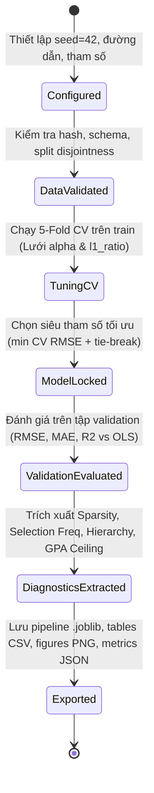

# Data Model: Elastic Net Regression — Conditional GPA Prediction

## 1. Raw Input & Target Schema

| Tên biến | Nhóm | Logical dtype | Quy tắc tiền xử lý | Cấu hình Full | Cấu hình No-Anxiety |
| :--- | :--- | :--- | :--- | :---: | :---: |
| `Pre_Semester_GPA` | A (Academic) | float | Impute median train; trừ tâm $P_c = P - \overline{P}_{train}$ | ✓ | ✓ |
| `Traditional_Study_Hours` | A (Academic) | float | Impute median train; trừ tâm $S_c = S - \overline{S}_{train}$ | ✓ | ✓ |
| `Year_of_Study` | A (Academic) | categorical | One-Hot Encoding drop-first (5 levels $\to$ 4 dummies) | ✓ | ✓ |
| `Major_Category` | A (Academic) | categorical | One-Hot Encoding drop-first (5 levels $\to$ 4 dummies) | ✓ | ✓ |
| `Weekly_GenAI_Hours` | B (AI Usage) | float | Impute median train; trừ tâm $H_c = H - \overline{H}_{train}$ | ✓ | ✓ |
| `Primary_Use_Case` | B (AI Usage) | categorical | One-Hot Encoding drop-first (5 levels $\to$ 4 dummies $U_1 \dots U_4$) | ✓ | ✓ |
| `Prompt_Engineering_Skill` | B (AI Usage) | categorical | One-Hot Encoding drop-first (3 levels $\to$ 2 dummies $K_1, K_2$) | ✓ | ✓ |
| `Tool_Diversity` | B (AI Usage) | numeric | Impute median train | ✓ | ✓ |
| `Paid_Subscription` | B (AI Usage) | binary / bool | Ánh xạ nhị phân $0/1$ | ✓ | ✓ |
| `Institutional_Policy` | C (Contextual) | categorical | One-Hot Encoding drop-first (3 levels $\to$ 2 dummies) | ✓ | ✓ |
| `Perceived_AI_Dependency` | D (Psychological) | categorical | One-Hot Encoding drop-first (10 levels $\to$ 9 dummies) | ✓ | ✓ |
| `Anxiety_Level_During_Exams` | D (Psychological) | categorical | One-Hot Encoding drop-first (10 levels $\to$ 9 dummies) | ✓ | — (Ablated) |
| `Post_Semester_GPA` | Target | float | Cột mục tiêu liên tục $[0.0, 4.0]$; KHÔNG impute | y | y |

### Excluded Columns (Tuyệt đối không vào X)
- `Student_ID`: Định danh cá nhân, chỉ phục vụ kiểm tra tính toàn vẹn và phân vùng dữ liệu.
- `GPA_Change`: Biến dẫn xuất từ target ($GPA_{post} - GPA_{pre}$), gây rò rỉ mục tiêu tức thì.
- `Skill_Retention_Score`: Outcome đo lường sau kỳ học, không sẵn có tại cutoff dự đoán.
- `Burnout_Risk_Level`: Outcome đo lường sau kỳ học, rủi ro rò rỉ thời gian và mục tiêu cao.

---

## 2. Partition & Assignment Entities

| Entity | Các trường dữ liệu | Ràng buộc & Quy tắc |
| :--- | :--- | :--- |
| **Source Dataset** | `path`, `sha256`, `row_count` (50.000) | Dữ liệu gốc ở `data/raw/` hoặc `archive/`; chỉ đọc (read-only). |
| **Split Assignment** | `Student_ID`, `split` (`train`, `validation`, `test`) | Lưu trong `data/assignments.csv`; đối chiếu khớp mã băm trong `data/metadata.json`. |
| **Frozen Partitions** | `train` (35.000), `validation` (7.500), `test` (7.500) | Ba tập dữ liệu rời nhau 100% (`disjoint`); không trùng lặp ID giữa các tập. |
| **CV Fold Assignment** | `fold_id` (0–4), `train_indices`, `val_indices` | 5 folds ngẫu nhiên trên tập train (`KFold(n_splits=5, shuffle=True, random_state=42)`). |

---

## 3. Encoded Design & Feature Hierarchy

Mọi biến sau khi mã hóa One-Hot và tạo tương tác đều được đưa qua `StandardScaler` trước khi nạp vào bộ ước lượng `ElasticNet`. Số chiều $p$ được tính như sau (chưa bao gồm hệ số chặn `intercept` do estimator tự quản lý):

| Model Name | Các thành phần tích lũy | Công thức số terms khi đủ levels | Số chiều ma trận $X$ ($p$) |
| :--- | :--- | :--- | :---: |
| **EN1** | 12 raw features sau One-Hot Encoding | 5 numeric/binary + (4 + 4 + 4 + 2 + 2 + 9 + 9) dummies | **39 terms** |
| **EN2** (Standard) | `EN1` + Polynomial $H_c^2$ (thay thế $H$ thô bằng $H_c$) | $39 + 1 (H_c^2)$ | **40 terms** |
| **EN2** (Extended) | `EN1` + Polynomial $H_c^2 + P_c^2$ | $39 + 1 (H_c^2) + 1 (P_c^2)$ | **41 terms** |
| **EN3** (Full — Primary) | `EN2` + 3 nhóm biến tương tác 2 chiều | $40 + 4(H_c \times U_i) + 2(H_c \times K_j) + 8(U_i \times K_j)$ | **54 terms** (hoặc 55 nếu có $P_c^2$) |
| **EN3_no_anxiety** | `EN3` loại bỏ biến `Anxiety_Level_During_Exams` | $54 - 9$ dummies của Anxiety | **45 terms** (hoặc 46 nếu có $P_c^2$) |

### Ràng buộc về Collinearity trong EN2 & EN3
- Biến $H$ (Weekly_GenAI_Hours) sau khi trừ tâm là $H_c = H - \overline{H}$. Do $\overline{H}$ là hằng số và mô hình đã có `fit_intercept=True`, vector $H$ là tổ hợp tuyến tính của $H_c$ và cột hằng số 1. Vì vậy, **tuyệt đối không giữ đồng thời $H$ và $H_c$** trong ma trận thiết kế để tránh làm giảm hạng (rank deficiency) hoặc gây sai lệch phạt $L_1/L_2$.

---

## 4. Lifecycle & State Machine

- **Configured**: Khởi tạo cấu hình thực nghiệm, dải siêu tham số $\alpha \in [10^{-4}, 10^1]$ và $l_1\_ratio \in [0.1, 1.0]$.
- **DataValidated**: Xác nhận mã băm dữ liệu khớp `data/metadata.json`, đảm bảo không trùng ID.
- **TuningCV**: 5-Fold Cross-Validation chạy trên tập train; fit transformer và `StandardScaler` trong từng fold riêng biệt.
- **ModelLocked**: Chọn cặp $(\alpha^*, l_1\_ratio^*)$ theo quy tắc min CV RMSE và tie-break độ thưa; fit mô hình cuối cùng trên toàn bộ 35.000 dòng train.
- **ValidationEvaluated**: Đánh giá trên 7.500 dòng validation (tập test vẫn giữ nguyên `not executed`).
- **DiagnosticsExtracted**: Phân tích các hệ số khác 0, kiểm tra tính phân cấp, đếm số dự đoán ngoài miền $[0, 4]$.
- **Exported**: Xuất các file artifacts vào `outputs/elastic_net/`.
