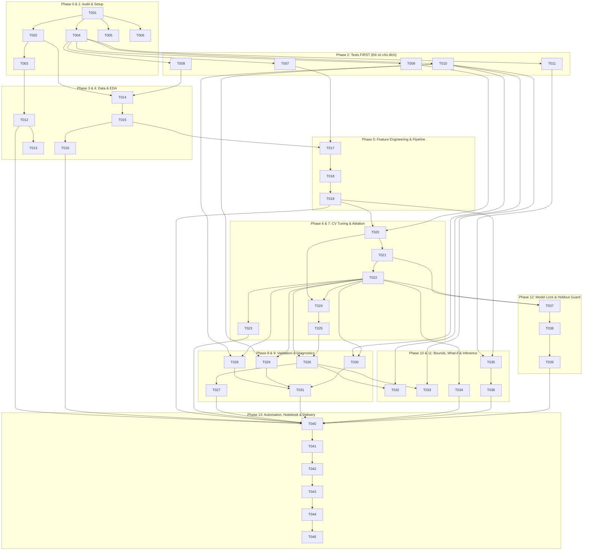

# Tasks: Elastic Net Regression — Conditional GPA Prediction

**Input**: [spec.md](spec.md), [plan.md](plan.md), [research.md](research.md), [data-model.md](data-model.md), [model-io.md](contracts/model-io.md), [quickstart.md](quickstart.md), [requirements.md](checklists/requirements.md).

**Format**: `- [x] Tnnn [P] [USn] Công việc — Pre: ...; Output: ...; Verify/evidence: ...; Gate: ...`.
- `[P]`: Đánh dấu task có thể thực hiện song song (không ghi đè cùng file và không phụ thuộc task chưa hoàn thành trong cùng nhóm).
- `[USn]`: Ánh xạ trực tiếp tới User Story trong [spec.md](spec.md).
- Mọi đường dẫn file tính từ repository root.
- **Quy ước chung**: Python $\ge 3.11$; lệnh `pytest` là `python -m pytest`; lệnh `python` dùng môi trường ảo đang kích hoạt.
- **Triết lý Tests FIRST**: Unit test được định nghĩa và tạo trước khi implement code; ban đầu test phải ĐỎ đúng lý do (thiếu tính năng/module), sau khi implement phải XANH. Không chấp nhận test đỏ vì lỗi cú pháp/môi trường.
- **Nguyên tắc Bảo vệ Holdout**: Tuyệt đối không đọc cột target của tập `test` trong bất kỳ task nào của giai đoạn phát triển; chỉ mở đánh giá tập `test` sau khi model lock và có biến môi trường `$env:LAB_GROUP_SPLIT_APPROVED = 'yes'`. Mọi đánh giá trung gian chỉ dùng 5-fold CV trên `train` và kiểm tra trên `validation`.

---

## Phase 0 — Audit & Đồng bộ Protocol

**Mục tiêu**: Kiểm tra dữ liệu sẵn có, xác nhận cấu trúc split, kiểm tra tính tương thích với repo và mô hình đối chứng `001-interaction-linear-regression`.

- [x] T001 Audit cấu trúc `src/lab01_ml/`, `tests/`, `requirements.txt` và ghi nhận trạng thái vào `outputs/elastic_net/audit.md` — Pre: Repo hiện tại; Output: Báo cáo audit các module có thể tái sử dụng (`data/loader.py`, `features/engineering.py`, `models/training.py`, `models/inference.py`); Verify/evidence: `git status` và `python -m pip list`; Gate: Xác nhận không ghi đè mã nguồn của nhánh 001.
- [x] T002 Audit tính toàn vẹn của dữ liệu trong `data/` (`assignments.csv`, `metadata.json`, `data/train/dataset.csv`, `data/validation/dataset.csv`, `data/test/dataset.csv`), bổ sung SHA-256, số dòng (35k/7.5k/7.5k) và kiểm tra ID disjointness vào `outputs/elastic_net/audit.md` — Pre: T001; Output: Báo cáo xác thực tính toàn vẹn của phân vùng đóng băng 70/15/15; Verify/evidence: `python -c "import hashlib, json; from pathlib import Path; meta=json.loads(Path('data/metadata.json').read_text()); print('Meta ok' if len(meta['dataset_sha256'])==3 else 'Error')"` ; Gate: Khớp hoàn toàn SHA-256 và counts; không tự ý resplit hay overwrite.
- [x] T003 Đồng bộ quyết định protocol vào `specs/002-elastic-net-regression/spec.md` và `specs/002-elastic-net-regression/plan.md`: tái sử dụng frozen split, khóa tập test (`final test: not executed`), EN1(39 terms)/EN2(40–41 terms)/EN3(54–55 terms), `StandardScaler` trong từng fold, tie-break $\le 0.1\%$ ưu tiên độ thưa — Pre: T001; Output: Spec và Plan hoàn chỉnh không mâu thuẫn; Verify/evidence: `rg -n 'EN1|EN2|EN3|StandardScaler|test_status|tie-break' specs/002-elastic-net-regression/`; Gate: Mọi ràng buộc toán học và chống rò rỉ dữ liệu đã được thống nhất.

---

## Phase 1 — Setup & Môi trường

**Mục tiêu**: Chuẩn bị cấu hình thực nghiệm, thư mục đầu ra và cập nhật dependencies.

- [x] T004 [P] Cập nhật `requirements.txt` đảm bảo đầy đủ các thư viện: `scikit-learn>=1.4.0`, `numpy`, `pandas`, `matplotlib`, `seaborn`, `joblib`, `nbformat`, `nbclient`, `pytest` — Pre: T001; Output: File `requirements.txt` được chuẩn hóa; Verify/evidence: `python -m pip install -r requirements.txt` và `python -m pip check`; Gate: Cài đặt thành công trên môi trường CPU thuần túy, không cần GPU hay mạng runtime.
- [x] T005 [P] Tạo file cấu hình `configs/elastic_net.yaml` chứa seed 42, dải siêu tham số $\alpha \in [10^{-4}, 10^1]$, $l_1\_ratio \in [0.1, 1.0]$, tie threshold 0.001, các đường dẫn dữ liệu và đường dẫn output `outputs/elastic_net/` — Pre: T001; Output: File `configs/elastic_net.yaml`; Verify/evidence: `python -c "import yaml; cfg=yaml.safe_load(open('configs/elastic_net.yaml')); assert cfg['seed']==42"`; Gate: Cấu hình không chứa đường dẫn tuyệt đối của máy cá nhân.
- [x] T006 [P] Khởi tạo cấu trúc thư mục lưu trữ artifacts tại `outputs/elastic_net/` (`models/`, `tables/`, `figures/`) kèm `.gitkeep` — Pre: T001; Output: Thư mục đầu ra sạch; Verify/evidence: `ls -la outputs/elastic_net/`; Gate: Không chứa các file tạm hay outputs rác.

---

## Phase 2 — Foundational: Tests FIRST

**Mục tiêu**: Xây dựng toàn bộ các bài kiểm thử tự động độc lập trước khi viết mã nguồn tính năng. Test ban đầu phải ĐỎ đúng lý do (thiếu module / phương thức), sau đó XANH khi hoàn thành implementation.

- [x] T007 [P] Viết `tests/test_elastic_net_features.py`: kiểm tra số terms chính xác khi đủ levels (EN1: 39 terms, EN2: 40–41 terms, EN3: 54–55 terms, EN3_no_anxiety: 45–46 terms); kiểm tra loại bỏ biến thô $H$ khi có intercept trong EN2; kiểm tra mã hóa danh mục lạ thành vector 0 kèm warning — Pre: T004; Output: File `tests/test_elastic_net_features.py`; Verify/evidence: `python -m pytest tests/test_elastic_net_features.py -q`; Gate: Test ĐỎ vì `ElasticNetFeatures` chưa được cài đặt.
- [x] T008 [P] Viết bổ sung vào `tests/test_leakage_and_splits.py`: kiểm tra tính toàn vẹn của mã băm dữ liệu, tính rời rạc 100% của `Student_ID`, kiểm tra `StandardScaler` và `ElasticNetFeatures` chỉ fit trên training partition của từng fold, không rò rỉ phương sai sang validation/test — Pre: T004; Output: Test suite kiểm tra leakage cập nhật; Verify/evidence: `python -m pytest tests/test_leakage_and_splits.py -k elastic_net -q`; Gate: Test ĐỎ vì hàm nạp và pipeline chưa hoàn chỉnh.
- [x] T009 [P] Viết `tests/test_elastic_net_training.py`: kiểm tra quy trình 5-fold CV với seed 42, tính toán đầy đủ 4 metrics (RMSE, MAE, MSE, $R^2$), quy tắc tie-break $\le 0.1\%$ ưu tiên mô hình thưa hơn, và kiểm tra tính năng Group Ablation — Pre: T004; Output: File `tests/test_elastic_net_training.py`; Verify/evidence: `python -m pytest tests/test_elastic_net_training.py -q`; Gate: Test ĐỎ do chưa có module training.
- [x] T010 [P] Viết `tests/test_elastic_net_diagnostics.py`: kiểm tra trích xuất số hệ số khác 0, tính tỷ lệ thưa (sparsity rate), tần suất chọn biến qua 5 folds ($0/5 \dots 5/5$), kiểm tra vi phạm tính phân cấp (hierarchy check), và kiểm tra đếm dự đoán ngoài $[0.0, 4.0]$ không dùng clip — Pre: T004; Output: File `tests/test_elastic_net_diagnostics.py`; Verify/evidence: `python -m pytest tests/test_elastic_net_diagnostics.py -q`; Gate: Test ĐỎ do chưa có module chẩn đoán.
- [x] T011 [P] Viết `tests/test_elastic_net_inference.py`: kiểm tra hàm `predict_student` nhận đúng 12 raw features, ném lỗi `ValueError` khi thiếu cột hoặc sai kiểu, cảnh báo out-of-domain hoặc unknown category, và kiểm tra nạp lại file pipeline `.joblib` cho kết quả dự đoán trùng khớp sai số $< 10^{-9}$ — Pre: T004; Output: File `tests/test_elastic_net_inference.py`; Verify/evidence: `python -m pytest tests/test_elastic_net_inference.py -q`; Gate: Test ĐỎ do chưa có module inference cho Elastic Net.

---

## Phase 3 — US1: Đọc hiểu Bài toán & Lý thuyết Elastic Net (P1)

**Mục tiêu**: Người học nắm vững bản chất toán học của Elastic Net, hàm mất mát kết hợp $L_1 + L_2$, cơ chế Coordinate Descent và cách xử lý đa cộng tuyến (grouping effect).

- [x] T012 [US1] Xây dựng các hàm diễn giải lý thuyết toán học Elastic Net và ví dụ tính tay cập nhật hệ số dạng soft-thresholding có thêm co $L_2$ — Pre: T003; Output: Tài liệu giải thích và mã nguồn minh họa trong `notebooks/elastic_net_regression.ipynb` (Phần 01 & 12); Verify/evidence: Kiểm tra công thức LaTeX trong notebook hiển thị chuẩn mực; Gate: Tính toán tay và code đối chiếu khớp nhau.
- [x] T013 [US1] Xây dựng bảng so sánh lý thuyết giữa OLS, Ridge ($L_2$), Lasso ($L_1$), và Elastic Net ($L_1+L_2$) về hành vi chọn biến, đa cộng tuyến và độ ổn định — Pre: T012; Output: Markdown so sánh trong notebook; Verify/evidence: Đối chiếu với [research.md](research.md); Gate: Nội dung khoa học chính xác, không mâu thuẫn.

---

## Phase 4 — US2: Dữ liệu, Schema & Leakage Guard (P1)

**Mục tiêu**: Nạp dữ liệu an toàn từ phân vùng đóng băng, ngăn ngừa rò rỉ target và loại trừ triệt để các biến cấm.

- [x] T014 [US2] Cập nhật và hoàn thiện `src/lab01_ml/data/loader.py`: hỗ trợ nạp dữ liệu từ cả `data/splits/` và `data/{train,validation,test}/dataset.csv`, đối chiếu mã băm với `data/metadata.json` và `data/assignments.csv`, chỉ đọc cột `Student_ID` từ tập test để audit phân vùng — Pre: T002, T008; Output: Hàm `load_frozen(root)` hoàn chỉnh; Verify/evidence: `python -m pytest tests/test_leakage_and_splits.py -k test_frozen -q`; Gate: Test XANH; mã băm và counts khớp 100%, không nạp target tập test.
- [x] T015 [US2] Xây dựng hàm kiểm tra và loại trừ bắt buộc các cột `Student_ID`, `GPA_Change`, `Skill_Retention_Score`, `Burnout_Risk_Level` trong `src/lab01_ml/data/preprocessing.py` — Pre: T014; Output: Hàm `validate_raw_inputs(df, is_training=True)`; Verify/evidence: `python -m pytest tests/test_leakage_and_splits.py -k test_exclusion -q`; Gate: Ném ngoại lệ rõ ràng nếu phát hiện cột cấm lọt vào ma trận đặc trưng $X$.
- [x] T016 [US2] Xây dựng phần khám phá dữ liệu ban đầu (EDA) trên tập train: vẽ phân phối `Post_Semester_GPA` (Hình 01), phân phối `Weekly_GenAI_Hours` (Hình 02), phân tán AI Hours vs GPA Change (Hình 03), và heatmap GPA trung bình theo nhóm Use Case $\times$ Prompt Skill (Hình 04) trong `src/lab01_ml/visualization/plots.py` — Pre: T014; Output: Các hàm vẽ biểu đồ EDA train-only; Verify/evidence: Chạy hàm xuất 4 hình PNG vào `outputs/elastic_net/figures/`; Gate: Biểu đồ đầy đủ title, labels, nguồn dữ liệu tập train, và không dùng dữ liệu validation/test.

---

## Phase 5 — US3: Feature Engineering EN1, EN2, EN3 & Pipeline với StandardScaler (P1)

**Mục tiêu**: Xây dựng transformer `ElasticNetFeatures` sinh đúng số terms cho EN1, EN2, EN3 và đóng gói hoàn chỉnh trong `Pipeline` cùng `StandardScaler`.

- [x] T017 [US3] Cài đặt lớp `ElasticNetFeatures` trong `src/lab01_ml/features/elastic_net_features.py` kế thừa `BaseEstimator` và `TransformerMixin`: fit median/mode train-only, OneHotEncoder drop-first, centering $H_c = H - \overline{H}_{train}$, xử lý unknown categories thành vector 0 kèm UserWarning — Pre: T007; Output: Module `src/lab01_ml/features/elastic_net_features.py`; Verify/evidence: `python -m pytest tests/test_elastic_net_features.py -k test_ohe_and_centering -q`; Gate: Test XANH; các tham số thống kê chỉ học trên tập train.
- [x] T018 [US3] Hoàn thiện việc sinh các không gian đặc trưng EN1 (39 terms), EN2 (40–41 terms với $H_c^2$, loại bỏ raw $H$ khi có intercept), EN3 (54–55 terms với 14 interaction terms), và EN3_no_anxiety (45–46 terms) trong `ElasticNetFeatures` — Pre: T017, T007; Output: Phương thức `transform` và `get_feature_names_out`; Verify/evidence: `python -m pytest tests/test_elastic_net_features.py -k test_feature_counts -q`; Gate: Test XANH; số chiều khớp chính xác 39, 40, 54, 45 terms khi đủ levels.
- [x] T019 [US3] Cài đặt hàm dựng Pipeline trong `src/lab01_ml/models/factory.py`: tích hợp `ElasticNetFeatures` $\to$ `StandardScaler(with_mean=True, with_std=True)` $\to$ `ElasticNet(random_state=42, max_iter=10000, tol=1e-4)` — Pre: T018; Output: Hàm `create_elastic_net_pipeline(model_type, scenario, alpha, l1_ratio)`; Verify/evidence: `python -m pytest tests/test_elastic_net_features.py -k test_pipeline_creation -q`; Gate: Pipeline tương thích hoàn toàn với scikit-learn, hỗ trợ clone và serialize.

---

## Phase 6 — US4: Tinh chỉnh Siêu tham số qua 5-Fold Cross-Validation (P1)

**Mục tiêu**: Tìm kiếm cặp siêu tham số tối ưu $(\alpha^*, l_1\_ratio^*)$ cho EN1, EN2, EN3 bằng 5-fold CV trên tập train, áp dụng quy tắc tie-break ưu tiên độ thưa.

- [x] T020 [US4] Cài đặt vòng lặp 5-fold Cross-Validation trên tập train với seed 42 trong `src/lab01_ml/models/elastic_net_training.py`: thực hiện clone pipeline và fit riêng biệt trong từng fold, tính toán MAE, MSE, RMSE, $R^2$ trung bình $\pm$ sd cho từng cặp $(\alpha, l_1\_ratio)$ — Pre: T009, T019; Output: Hàm `tune_elastic_net_grid()`; Verify/evidence: `python -m pytest tests/test_elastic_net_training.py -k test_cv_tuning -q`; Gate: Test XANH; không có hiện tượng rò rỉ dữ liệu giữa các fold.
- [x] T021 [US4] Cài đặt quy tắc chọn mô hình tối ưu và chính sách tie-break $\le 0.1\%$ ($1.001 \times \min$) ưu tiên mô hình có độ thưa lớn hơn (ít hệ số khác 0 hơn) trong `src/lab01_ml/models/elastic_net_training.py` — Pre: T020; Output: Hàm `select_best_elastic_net(cv_results_df)`; Verify/evidence: `python -m pytest tests/test_elastic_net_training.py -k test_tie_break -q`; Gate: Test XANH; lựa chọn có tính tất định (deterministic).
- [x] T022 [US4] Cài đặt hàm huấn luyện mô hình tối ưu cuối cùng trên toàn bộ 35.000 dòng train với $(\alpha^*, l_1\_ratio^*)$ đã chọn trong `src/lab01_ml/models/elastic_net_training.py` — Pre: T021; Output: Hàm `fit_final_elastic_net(X_train, y_train, best_params)`; Verify/evidence: `python -m pytest tests/test_elastic_net_training.py -k test_final_fit -q`; Gate: Mô hình fit hoàn chỉnh, không chạm vào tập validation để fit.
- [x] T023 [US4] Xây dựng biểu đồ bề mặt sai số siêu tham số (Heatmap Validation RMSE theo $\alpha$ và $l_1\_ratio$ - Hình 05) và đồ thị so sánh CV RMSE $\pm$ sd giữa EN1, EN2, EN3 vs OLS (Hình 07) trong `src/lab01_ml/visualization/plots.py` — Pre: T020; Output: Các hàm trực quan hóa kết quả tuning; Verify/evidence: Xuất thử nghiệm PNG và kiểm tra labels/titles; Gate: Biểu đồ trực quan, thể hiện rõ vùng cực tiểu của sai số.

---

## Phase 7 — US5: Group Ablation (No-Anxiety) & Phân tích Đánh đổi (P1)

**Mục tiêu**: Đánh giá tác động của việc loại bỏ `Anxiety_Level_During_Exams` để kiểm soát rủi ro rò rỉ thời gian trước kỳ thi.

- [x] T024 [US5] Mở rộng hàm tuning và training trong `src/lab01_ml/models/elastic_net_training.py` hỗ trợ kịch bản `scenario='no_anxiety'` (tạo cấu hình `EN3_no_anxiety`) — Pre: T020, T022; Output: Hàm `train_ablation_model()`; Verify/evidence: `python -m pytest tests/test_elastic_net_training.py -k test_ablation -q`; Gate: Huấn luyện thành công mô hình 45–46 terms trên cùng 5-fold CV.
- [x] T025 [US5] Xây dựng bảng so sánh chi tiết hiệu năng giữa mô hình Full và No-Anxiety trên tập validation: định lượng mức độ suy giảm RMSE, MAE, $R^2$ và phân tích sự đánh đổi khi chuyển sang dự báo trước kỳ thi — Pre: T024; Output: File `outputs/elastic_net/tables/ablation_comparison.csv`; Verify/evidence: Đối chiếu với tiêu chí trong [spec.md](spec.md#functional-requirements); Gate: Báo cáo đầy đủ n, metrics và nhận xét định lượng.

---

## Phase 8 — US6: Đánh giá Validation & So sánh OLS Baseline (P1)

**Mục tiêu**: Đánh giá các mô hình Elastic Net trên tập `validation` độc lập (7.500 dòng), so sánh định lượng với baseline OLS từ mô hình `001-interaction-linear-regression`.

- [x] T026 [US6] Cài đặt hàm đánh giá tập validation trong `src/lab01_ml/models/elastic_net_evaluation.py`: tính toán RMSE, MAE, MSE, $R^2$ cho EN1, EN2, EN3, EN3_no_anxiety và nạp kết quả OLS baseline để so sánh — Pre: T022, T025; Output: Hàm `evaluate_on_validation()`; Verify/evidence: `python -m pytest tests/test_elastic_net_training.py -k test_validation_eval -q`; Gate: Bảng so sánh được lưu thành `outputs/elastic_net/tables/model_comparison.csv`.
- [x] T027 [US6] Xây dựng biểu đồ so sánh Validation RMSE và $R^2$ giữa OLS vs Elastic Net (Hình 08) và đồ thị quỹ đạo hệ số hồi quy (Regularization Path - Hình 06) thể hiện quá trình co hệ số khi $\alpha$ tăng trong `src/lab01_ml/visualization/plots.py` — Pre: T026; Output: Các hàm vẽ biểu đồ so sánh; Verify/evidence: Xuất 2 file PNG độ phân giải 300 DPI vào `outputs/elastic_net/figures/`; Gate: Biểu đồ có chú thích rõ ràng, thể hiện rõ ưu thế co phương sai của Elastic Net trước đa cộng tuyến.

---

## Phase 9 — US7: Trích xuất Đặc thù Elastic Net: Sparsity, Selection Frequency & Hierarchy (P1)

**Mục tiêu**: Trích xuất các chỉ số nội tại chuyên sâu của Elastic Net để hiểu rõ cơ chế co hệ số và chọn lọc đặc trưng.

- [x] T028 [US7] Cài đặt hàm trích xuất số hệ số khác 0 ($k$) và tính tỷ lệ thưa ($\% = (1 - k/p) \times 100$) trong `src/lab01_ml/models/elastic_net_evaluation.py` — Pre: T010, T022; Output: Hàm `extract_sparsity_metrics()`; Verify/evidence: `python -m pytest tests/test_elastic_net_diagnostics.py -k test_sparsity -q`; Gate: Test XANH; lưu danh sách hệ số vào `outputs/elastic_net/tables/non_zero_coefficients.csv`.
- [x] T029 [US7] Cài đặt hàm thống kê tần suất chọn biến qua 5 folds CV ($0/5 \dots 5/5$) trong `src/lab01_ml/models/elastic_net_evaluation.py` — Pre: T010, T020; Output: Hàm `calculate_selection_frequency()`; Verify/evidence: `python -m pytest tests/test_elastic_net_diagnostics.py -k test_selection_freq -q`; Gate: Test XANH; xuất bảng `outputs/elastic_net/tables/selection_frequency.csv`.
- [x] T030 [US7] Cài đặt hàm kiểm tra tính phân cấp (Hierarchy check) đối với các biến tương tác $H_c \cdot U_i$, $H_c \cdot K_j$, $U_i \cdot K_j$ trong `src/lab01_ml/models/elastic_net_evaluation.py`: ghi nhận các trường hợp biến tương tác $\neq 0$ nhưng biến thành phần bị triệt tiêu về 0 — Pre: T010, T028; Output: Hàm `check_hierarchy()`; Verify/evidence: `python -m pytest tests/test_elastic_net_diagnostics.py -k test_hierarchy -q`; Gate: Test XANH; xuất báo cáo `outputs/elastic_net/tables/hierarchy_check.csv`.
- [x] T031 [US7] Xây dựng biểu đồ tần suất chọn biến (Hình 10) và biểu đồ độ lớn các hệ số khác 0 được giữ lại (Hình 09) trong `src/lab01_ml/visualization/plots.py` — Pre: T028, T029; Output: Hàm vẽ biểu đồ chẩn đoán đặc thù; Verify/evidence: Xuất 2 file PNG vào `outputs/elastic_net/figures/`; Gate: Biểu đồ trực quan, phân định rõ nhóm biến cốt lõi ($5/5$) và nhóm biến bị triệt tiêu ($0/5$).

---

## Phase 10 — US8: Kiểm soát Trần GPA & Phân tích Kịch bản What-if (P1)

**Mục tiêu**: Phát hiện dự đoán ngoài phạm vi hợp lệ $[0.0, 4.0]$ và xây dựng giao diện phân tích kịch bản What-if theo giờ dùng AI.

- [x] T032 [US8] Cài đặt hàm kiểm tra trần/sàn GPA trong `src/lab01_ml/models/elastic_net_evaluation.py`: đếm số lượng và tính tỷ lệ phần trăm dự đoán $\hat{y} > 4.0$ hoặc $\hat{y} < 0.0$ trên tập validation, cam kết tuyệt đối không dùng hàm `clip()` âm thầm — Pre: T010, T026; Output: Hàm `check_gpa_bounds(y_pred)`; Verify/evidence: `python -m pytest tests/test_elastic_net_diagnostics.py -k test_bounds -q`; Gate: Test XANH; tỷ lệ out-of-bounds được ghi nhận trung thực.
- [x] T033 [US8] Cài đặt biểu đồ chẩn đoán phần dư (Residuals vs Fitted - Hình 11) kiểm tra tính đồng nhất phương sai sai số trên tập validation trong `src/lab01_ml/visualization/plots.py` — Pre: T026; Output: Hàm vẽ residual plot; Verify/evidence: Xuất file PNG vào `outputs/elastic_net/figures/11_residuals_vs_fitted.png`; Gate: Biểu đồ thể hiện rõ đường baseline residual = 0 và dải phân tán.
- [x] T034 [US8] Xây dựng biểu đồ phân tích What-if theo giờ AI (Hình 12): cố định 11 biến nền tại hồ sơ tiêu chuẩn và quét `Weekly_GenAI_Hours` từ 0 đến 40 giờ trên các nhóm Use Case và Prompt Skill trong `src/lab01_ml/visualization/plots.py` — Pre: T022; Output: Hàm vẽ đường cong What-if; Verify/evidence: Xuất file PNG vào `outputs/elastic_net/figures/12_what_if_response_curves.png`; Gate: Đồ thị có chú thích rõ ràng rằng đây là mô phỏng có điều kiện, không phải can thiệp nhân quả.

---

## Phase 11 — US9: Tích hợp Giao diện Dự đoán & Xuất Pipeline .joblib (P1)

**Mục tiêu**: Cung cấp hàm `predict_student` nhận 12 raw features và xuất mô hình pipeline hoàn chỉnh dạng `.joblib` cho ứng dụng.

- [x] T035 [US9] Cài đặt hàm `predict_student(raw_dict, model_pipeline)` trong `src/lab01_ml/models/inference.py`: nhận dictionary 12 raw features, xác thực tính hợp lệ (kiểu dữ liệu, giá trị âm, missing), cảnh báo unknown category hoặc out-of-domain, và trả về dict kết quả chuẩn — Pre: T011, T019; Output: Hàm `predict_student()`; Verify/evidence: `python -m pytest tests/test_elastic_net_inference.py -k test_predict_student -q`; Gate: Test XANH; xử lý ngoại lệ an toàn và minh bạch.
- [x] T036 [US9] Xuất trained Pipeline đã fit trên toàn bộ tập train ra file `outputs/elastic_net/models/selected_elastic_net_pipeline.joblib` kèm xác thực nạp lại (round-trip test) — Pre: T022, T035; Output: File nhị phân `.joblib` tại đường dẫn quy định; Verify/evidence: `python -m pytest tests/test_elastic_net_inference.py -k test_joblib_reload -q`; Gate: Test XANH; nạp lại pipeline và dự đoán thành công với sai số $< 10^{-9}$.

---

## Phase 12 — US10: Khóa Mô hình, Final Test Guard & Bàn giao Nghiệm thu (P1)

**Mục tiêu**: Lưu vết mô hình trước khi mở test, bảo vệ tập holdout, và chỉ kích hoạt đánh giá tập test khi có phê duyệt.

- [x] T037 [US10] Cài đặt cơ chế khóa mô hình trong `src/lab01_ml/models/elastic_net_training.py`: ghi nhận `outputs/elastic_net/model_lock.json` chứa thông tin siêu tham số tối ưu, mã băm dữ liệu, CV scores và thời điểm khóa — Pre: T021, T022; Output: File `model_lock.json`; Verify/evidence: `python -c "import json; d=json.load(open('outputs/elastic_net/model_lock.json')); assert 'selected_model' in d"`; Gate: Khóa mô hình hoàn tất trước khi có bất kỳ truy cập nào tới tập test.
- [x] T038 [US10] Cài đặt cơ chế bảo vệ holdout (Test Guard) trong script và notebook: mặc định ghi nhận `final_test: not executed` trong `outputs/elastic_net/metrics.json`; chỉ nạp tập `test` và đánh giá một lần duy nhất khi biến môi trường `LAB_GROUP_SPLIT_APPROVED == 'yes'` — Pre: T037; Output: Module đánh giá test có điều kiện; Verify/evidence: Chạy với và không có biến môi trường để xác minh hành vi; Gate: Mặc định không đọc target tập test.
- [x] T039 [US10] Tổng hợp và ghi nhận file `outputs/elastic_net/metrics.json` lưu trữ toàn bộ chỉ số tối ưu: CV scores, validation metrics, độ thưa, tỷ lệ ngoài miền, và trạng thái tập test — Pre: T026, T028, T032, T038; Output: File `outputs/elastic_net/metrics.json`; Verify/evidence: `python -c "import json; m=json.load(open('outputs/elastic_net/metrics.json')); assert 'validation_metrics' in m"`; Gate: File JSON hợp lệ, tuân thủ đúng hợp đồng I/O.

---

## Phase 13 — Scripts Tự động hóa, Notebook Execution & Kiểm tra Nhất quán

**Mục tiêu**: Xây dựng các script tạo và chạy notebook trong clean kernel, đối chiếu tính nhất quán giữa bảng số liệu và biểu đồ.

- [x] T040 [P] Viết script `scripts/build_elastic_net_notebook.py` sử dụng thư viện `nbformat` để tự động dựng cấu trúc notebook 34 phần bằng tiếng Việt, công thức LaTeX chuẩn và code cells hoàn chỉnh tại `notebooks/elastic_net_regression.ipynb` — Pre: T012–T039; Output: Script `scripts/build_elastic_net_notebook.py` và notebook `notebooks/elastic_net_regression.ipynb`; Verify/evidence: `python scripts/build_elastic_net_notebook.py` và `python -c "import nbformat; nbformat.validate(nbformat.read('notebooks/elastic_net_regression.ipynb', 4))"`; Gate: Notebook hợp lệ nbformat 4, đủ 34 mục.
- [x] T041 Viết script `scripts/execute_elastic_net_notebook.py` sử dụng `nbclient.NotebookClient` để thực thi notebook trong kernel sạch, xuất notebook đã chạy ra `outputs/elastic_net/executed_notebook.ipynb` — Pre: T040; Output: Script `scripts/execute_elastic_net_notebook.py`; Verify/evidence: Kiểm tra cú pháp và khả năng bắt lỗi timeout/exception của script; Gate: Thực thi tin cậy, lưu notebook kể cả khi có ngoại lệ.
- [x] T042 Viết `tests/test_notebook_smoke.py` kiểm tra cấu trúc 34 mục của notebook, kiểm tra tính hợp lệ của mã nguồn tế bào (syntax validation), và kiểm tra tính nhất quán giữa số liệu trong các bảng CSV và biểu đồ PNG — Pre: T040, T041; Output: File `tests/test_notebook_smoke.py`; Verify/evidence: `python -m pytest tests/test_notebook_smoke.py -q`; Gate: Test XANH; không có sự mâu thuẫn giữa số liệu trong bảng và hình ảnh.
- [x] T043 Thực hiện chạy kiểm thử toàn bộ test suite: `python -m pytest tests/ -q` và `python -m unittest discover -s tests -p 'test_*.py'` — Pre: T007–T042; Output: Toàn bộ unit tests vượt qua thành công; Verify/evidence: Exit code 0, không có lỗi hay warnings bất thường; Gate: 100% tests XANH.
- [x] T044 Chạy thực thi notebook trong kernel sạch bằng `python scripts/execute_elastic_net_notebook.py` và kiểm tra toàn bộ artifacts sinh ra trong `outputs/elastic_net/` — Pre: T043; Output: File `outputs/elastic_net/executed_notebook.ipynb`, 12 file PNG trong `figures/`, các bảng CSV trong `tables/`, model `.joblib` và file `metrics.json`; Verify/evidence: Kiểm tra sự tồn tại và dung lượng của các artifacts; Gate: Toàn bộ cells có kết quả thực thi thực tế, không bị lỗi gãy kernel.
- [x] T045 Cập nhật tài liệu `README.md` tại thư mục gốc bổ sung hướng dẫn chạy cho nhánh Elastic Net Regression (lệnh build, execute, pytest trên Windows/Linux/Kaggle/Colab) — Pre: T044; Output: Mục hướng dẫn Elastic Net trong `README.md`; Verify/evidence: `rg -n 'elastic_net' README.md`; Gate: Hướng dẫn rõ ràng, liên kết chính xác tới notebook và artifacts.

---

## Dependencies & Execution Order

### Các nhóm có thể thực hiện song song (Parallel Safe `[P]`)
- **T004, T005, T006**: Cấu hình, requirements và tạo thư mục output.
- **T007, T008, T009, T010, T011**: Viết các file unit test độc lập trước khi code.
- **T012, T013**: Soạn thảo phần lý thuyết toán học và bảng so sánh OLS vs Elastic Net.
- **T028, T029, T030**: Trích xuất độ thưa, tần suất chọn biến và kiểm tra tính phân cấp.
- **T032, T033, T034**: Kiểm tra trần GPA, vẽ residual plot và đường cong What-if.

---

## Ma trận Truy vết Yêu cầu (Requirement Traceability Matrix)

| Yêu cầu trong Spec | Task(s) Thực hiện & Kiểm chứng | Artifacts Đầu ra & Bằng chứng |
| :--- | :--- | :--- |
| **FR-001 (Ngôn ngữ & Bố cục)** | T012, T040, T044 | `notebooks/elastic_net_regression.ipynb` (34 phần tiếng Việt, LaTeX) |
| **FR-002 (12 Raw Inputs)** | T014, T015, T035 | `src/lab01_ml/data/loader.py`, `tests/test_elastic_net_inference.py` |
| **FR-003 (Loại trừ 4 Cột Cấm)** | T015, T008 | `src/lab01_ml/data/preprocessing.py`, `tests/test_leakage_and_splits.py` |
| **FR-004 (Đóng băng Phân vùng 70/15/15)** | T002, T014 | `data/assignments.csv`, `data/metadata.json`, `audit.md` |
| **FR-005 (Bảo vệ Holdout Test)** | T014, T038, T039 | `outputs/elastic_net/metrics.json` (`final test: not executed`) |
| **FR-006 (Đóng gói Pipeline khép kín)** | T017, T019, T020 | `src/lab01_ml/models/factory.py`, `tests/test_leakage_and_splits.py` |
| **FR-007 (Feature Set EN1 - 39 terms)** | T017, T018, T007 | `tests/test_elastic_net_features.py` (Assert count = 39) |
| **FR-008 (Feature Set EN2 - 40–41 terms)** | T018, T007 | `tests/test_elastic_net_features.py` (Assert count = 40, no raw $H$) |
| **FR-009 (Feature Set EN3 - 54–55 terms)** | T018, T007 | `tests/test_elastic_net_features.py` (Assert count = 54, 14 interactions) |
| **FR-010 (Chuẩn hóa StandardScaler)** | T019, T008 | `src/lab01_ml/models/factory.py` (`StandardScaler` trong pipeline) |
| **FR-011 (5-Fold CV Tuning)** | T020, T009 | `outputs/elastic_net/tables/cv_tuning_grid.csv` |
| **FR-012 (Quy tắc Chọn & Tie-Break)** | T021, T009 | `src/lab01_ml/models/elastic_net_training.py` (ngưỡng $\le 0.1\%$ thưa hơn) |
| **FR-013 (Group Ablation No-Anxiety)** | T024, T025, T009 | `outputs/elastic_net/tables/ablation_comparison.csv` (45 terms) |
| **FR-014 (Đánh giá Validation vs OLS)** | T026, T027 | `outputs/elastic_net/tables/model_comparison.csv`, Hình 08 |
| **FR-015 (Sparsity, Freq & Hierarchy)** | T028, T029, T030, T031 | `non_zero_coefficients.csv`, `selection_frequency.csv`, `hierarchy_check.csv` |
| **FR-016 (Kiểm soát Trần GPA 4.0)** | T032, T010 | `outputs/elastic_net/metrics.json` (out-of-bounds count/rate, no clip) |
| **FR-017 (Ghi nhận Giới hạn Nghiên cứu)**| T040, T045 | Mục 34 của notebook & `README.md` (synthetic, retrospective, term-level) |
| **FR-018 (Interface predict_student)** | T035, T011 | `src/lab01_ml/models/inference.py`, `tests/test_elastic_net_inference.py` |
| **FR-019 (Phân tích What-if)** | T034, T040 | `outputs/elastic_net/figures/12_what_if_response_curves.png` |
| **FR-020 (Tối thiểu 10 Biểu đồ Thực)** | T016, T023, T027, T031, T033, T034 | 12 file PNG độ phân giải 300 DPI trong `outputs/elastic_net/figures/` |
| **FR-021 (Xuất Pipeline .joblib)** | T036, T011 | `outputs/elastic_net/models/selected_elastic_net_pipeline.joblib` |
| **FR-022 (Lưu trữ Artifacts Đầy đủ)** | T039, T044 | Thư mục `outputs/elastic_net/` (executed notebook, bảng, hình, JSON) |
| **FR-023 (Cấu trúc Module Tái sử dụng)**| T014, T017, T019, T020, T028, T035 | Package `src/lab01_ml/` |
| **FR-024 (Bộ Unit Tests Toàn diện)** | T007–T011, T042, T043 | Toàn bộ các file kiểm thử trong `tests/` |

---

## Ghi chú Quan trọng cho Quá trình Thực thi

1. **Tuân thủ Tests FIRST**: Luôn tạo hoặc cập nhật file test tương ứng và chạy xác nhận test ĐỎ đúng lý do trước khi viết mã nguồn tính năng.
2. **Không Rò rỉ Thông tin Tập Test**: Tuyệt đối không cho phép bất kỳ dòng code nào nạp cột `Post_Semester_GPA` của tập test trong quá trình phát triển và lựa chọn mô hình.
3. **Thực thi trên Clean Kernel**: Mọi đánh giá nghiệm thu cuối cùng bắt buộc phải được chạy thông qua `scripts/execute_elastic_net_notebook.py` để đảm bảo notebook có thể chạy độc lập từ đầu đến cuối (`Restart Kernel & Run All Cells`) mà không phụ thuộc vào trạng thái bộ nhớ đệm.
